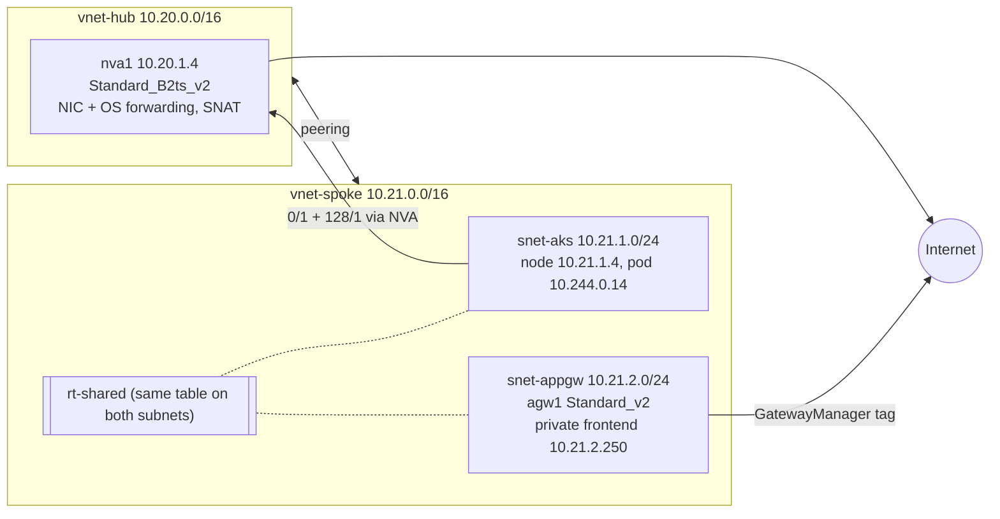

# AKS kubenet + legacy Application Gateway v2 sharing one UDR

**Question:** can a `GatewayManager → Internet` route let a legacy (non-network-isolated) Application Gateway v2, sharing a route table with a kubenet AKS subnet, survive a forced-tunnel default route to a hub NVA?

**Short answer (observed, one bounded run, `swedencentral`, 2026-10-09):** a literal `0.0.0.0/0 → NVA` is rejected by Azure. Two `/1` routes via the NVA are accepted and pod egress then goes through the NVA, but Application Gateway backend health becomes `Unknown` until a `GatewayManager → Internet` route is added; backend health then returned `Healthy`. This is an **unsupported workaround that was observed, not a production recommendation**, and only backend health was checked, not full control-plane functionality. Microsoft documents that a non-isolated v2 gateway does not support a `0.0.0.0/0` NVA route.

## Topology



Official Azure icons/geometry are intentionally omitted.

## Actual setup

- AKS Free tier, Kubernetes 1.35, kubenet, one `Standard_D2as_v5` node, AGIC add-on, sample pod `10.244.0.14` behind `agw1`.
- Application Gateway `Standard_v2` with a public frontend and a private frontend `10.21.2.250`. Feature `EnableApplicationGatewayNetworkIsolation` stayed `NotRegistered` (legacy mode); the private frontend is not private deployment/network isolation.
- NVA `Standard_B2ts_v2` at `10.20.1.4` with NIC IP forwarding, OS `ip_forward` and SNAT.
- One route table, `rt-shared`, attached to both spoke subnets: default `0.0.0.0/0 → Internet` plus the AKS-managed pod route.
- The temporary probe VM/subnet in the original design was not deployed.

## Observed results

| Step | Result |
|---|---|
| Baseline (12:28 UTC) | `agw1` Succeeded/Running, backend Healthy (HTTP 200). See [baseline-verdict.md](baseline-verdict.md). |
| Literal `0.0.0.0/0 → NVA` | Rejected: `ApplicationGatewaySubnetUserDefinedRouteNotAllowed`; no change. [verdict.json](show-output/forced-control-mutation-20261009T1241Z/verdict.json) |
| Split default `0.0.0.0/1` + `128.0.0.0/1 → NVA` | Accepted 12:53:35 UTC. Pod egress reported NVA public IP `20.91.222.168`. Backend-health query exited 0 but returned `Unknown` in 7 of 7 observations over more than 10 minutes (detail: ports 65503-65534; an API-reported status, not a CLI failure). [verdict](show-output/split-default-validation-20261009T1254Z/split-default-control-verdict.md) |
| Add `GatewayManager → Internet` | Admitted 13:08:39 UTC. First `Healthy` at 13:13:31 UTC (4m52s, an upper bound on first observation, not exact convergence); second `Healthy` at 13:15:02 UTC. Pod egress still via NVA. [verdict](show-output/gatewaymanager-validation-20261009T1309Z/treatment-verdict.md) |
| Scale the sample deployment from one to two replicas | `kubectl scale` and rollout succeeded at 14:40:55–14:40:58 UTC. The new pod `10.244.0.18` appeared beside `10.244.0.14`; AGIC logged the generated gateway configuration applied at 14:41:09 (about 14 seconds after scale). A successful pool query at 14:42:38–14:42:47 observed both IPs; both were later Healthy on public and private HTTP settings. This is a bounded historical observation, not proof of full control-plane behavior. [Offline evidence verdict](show-output/scale-two-validation-20261009T1454Z/validation-verdict.md) |

Post-scale `rt-shared` snapshot (2026-10-09 14:41:28–14:41:35 UTC; not a current-state claim): `0.0.0.0/0 → Internet`; `0.0.0.0/1` and `128.0.0.0/1 → 10.20.1.4`; pod `10.244.0.0/24 → 10.21.1.4`; `GatewayManager → Internet`. There is no pre-scale route snapshot, so this does not establish that routes were unchanged.

## Retained state

The treatment was retained at the last captured state on 2026-10-09. On
2026-10-12, cleanup was approved and the resource group deletion completed.
Independent `az group exists` checks returned `false` for both the lab resource
group and its AKS-managed node resource group. See the
[cleanup evidence](show-output/cleanup-20261012T0728Z/verified-deleted.json).
No live check was made after those verification commands; resource existence,
configuration, and cost are not asserted beyond that captured time.

## Reproduction

Uses the current `az` subscription; review scripts before running (they were authored for a lease-based run and not re-executed for publication):

```powershell
cd deploy
.\deploy.ps1 -Action Preflight; .\deploy.ps1 -Action Group
.\deploy.ps1 -Action Base; .\deploy.ps1 -Action Aks; .\deploy.ps1 -Action App
python .\forced-control-mutation.py      # literal 0/0 -> NVA (rejected)
python .\split-default-admission.py      # 0/1 + 128/1 -> NVA
python ..\show-output\gatewaymanager-mutation-20261009T1306Z\mutation.py   # GatewayManager -> Internet
```

For a scale-out check, first record the existing deployment, pods, EndpointSlices, Application Gateway pool, backend health, and route table; then run:

```powershell
kubectl scale deployment web -n default --replicas=2
kubectl rollout status deployment/web -n default --timeout=120s
kubectl get deployment web -n default -o wide
kubectl get pods -n default -l app=web -o wide
kubectl get endpointslices -n default -l kubernetes.io/service-name=web -o wide
az network application-gateway address-pool show -g rg-aks-agic-shared-udr --gateway-name agw1 -n pool-default-web-80-bp-80 -o json
az network application-gateway show-backend-health -g rg-aks-agic-shared-udr -n agw1 -o json
kubectl logs -n kube-system -l app=ingress-appgw --tail=400 --timestamps
az network route-table route list -g rg-aks-agic-shared-udr --route-table-name rt-shared -o json
```

Capture each command's timestamp, exit code, stdout, and stderr. Compare the pre/post pool and route snapshots; check health for every backend on both settings. Pod egress requires successful `kubectl exec` calls from each pod and should be reported separately from controller/gateway checks. The Oct 9 scale capture did not include a valid pre-scale pool query, and its later egress rechecks could not reach the Kubernetes API. See the [offline evidence verdict](show-output/scale-two-validation-20261009T1454Z/validation-verdict.md) for scope, exact observations, and timing caveats. Do not infer that the retained two-replica lab state still exists: `deploy\k8s\sample.yaml` intentionally remains a one-replica initial baseline.

The bounded capture helper is `deploy\scale-two-run.ps1`; it records pre/post
state to a new timestamped directory and uses PowerShell `ShouldProcess` before
scaling. `-WhatIf` still makes read-only Azure and Kubernetes queries. The
historical validation runner at
`show-output\scale-two-validation-20261009T1454Z\run_validation.py` writes each
run to a new timestamped directory and refuses to overwrite an existing output
directory. Neither helper was executed for this publication.

## Limitations

- Single run, one region, one node, one backend; timings are first-observation bounds.
- Backend health, pod egress, and one scale-out were observed. Gateway updates, metrics, certificates, cross-node behavior, and broad control-plane functionality were not tested.
- Unsupported by Microsoft; behavior may change without notice.
- Some early captures contain CLI help/error output from launcher argument-forwarding problems (retained, not counted as probes). `forced-control-mutation-20261009T1241Z/commands.json` and baseline files `30`-`33` include such unrelated text.
- The two-replica observation is also a single historical run. The pods landed on the same node; the AGIC configuration write and backend health were captured, but this is not a broad control-plane test. Post-scale pod egress and route-differential checks were inconclusive; the validation runner's final records span into Oct 10 after a long timeout. No Oct 12 live state was checked.

## Evidence

[`show-output/`](show-output/): `baseline-20261009T1228Z`, `forced-control-mutation-20261009T1241Z`, `split-default-mutation-20261009T1251Z`, `split-default-validation-20261009T1254Z`, `gatewaymanager-mutation-20261009T1306Z`, `gatewaymanager-validation-20261009T1309Z`, `scale-two-mutation-20261009T1439Z`, and `scale-two-validation-20261009T1454Z`. Planning documents: [lab-card.md](lab-card.md), [design.md](design.md) (historical).

**Sanitization:** subscription and tenant GUIDs, account names, user addresses,
resource UIDs, and AKS control-plane hostnames are redacted in retained captures.
Runtime control files and kubeconfigs are gitignored and not published. The NVA
public IP is an ordinary lab address.
