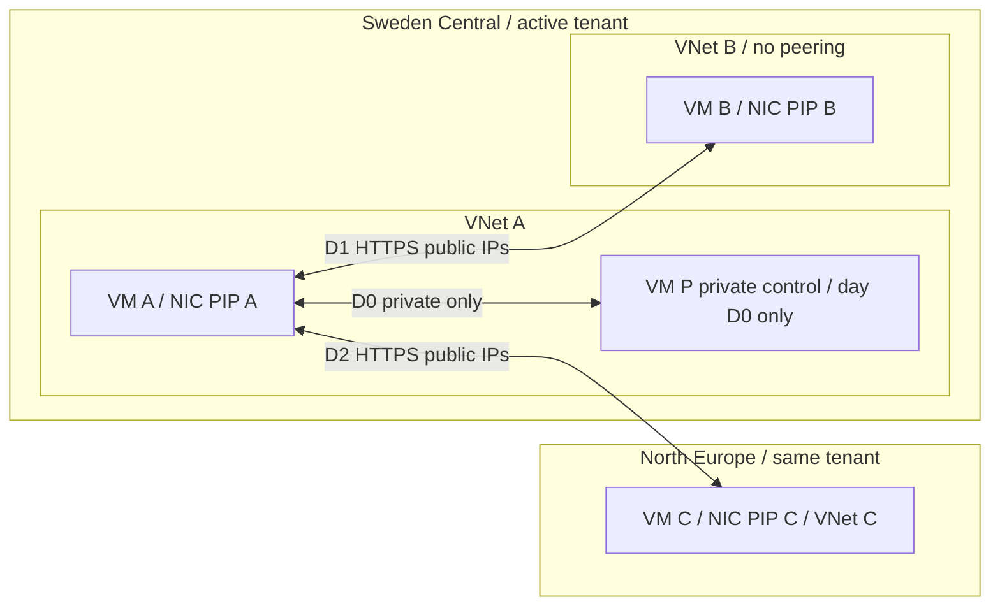

# Design: regional public-endpoint bandwidth classification

Research date: 2026-10-15; status updated 2026-10-16 UTC. **A ↔ T same-region,
cross-tenant public-IP transport PASS; restore PASS; billing INCONCLUSIVE**.
The [completed result](results/2026-10-15-cross-tenant-public-ip.md) supersedes
the original traffic order below, not historical deployment records. A/B/C/T
are now deleted with all known lab disks/PIPs. P's four resources were retired
before C deployment. [C → B v4](results/2026-10-15-cross-region-control.md)
transport/restoration PASS: **1 GiB**, one upload, no retries; independent
validation **23:25:22Z, 15 October**. Earlier v1/v2/v3 outcomes remain historical.
Expected-charged inter-region transport succeeded, but billing is still pending.
Known-owned cleanup closed PASS **16 October 00:00:11.806224Z**: 13 remaining
original core assets absent and C/T groups gone. **Core RG and one additional
NSG remain preserved**, creation ownership unproven; do not adopt/delete them.
Executable guarded ARM lives in `deploy`; see [deployment-log.md](deployment-log.md).
The temporary peer-only T rule was restored to its original deny baseline.

## Supported answer and boundary

For ordinary Microsoft-allocated regional public IPs in the same Azure billing
region, **no additional bandwidth fee is expected merely because tenants differ**.
The published same-region rule is unqualified by tenant; this practical answer
is not an experimental exemption for every cross-tenant SaaS architecture.
Verify regional placement and meters.
Verify IP ownership too: [the official BYOIP pricing exception](https://learn.microsoft.com/azure/virtual-network/ip-services/custom-ip-address-prefix#pricing)
states “All traffic destined to a custom IP prefix range is charged the internet
egress rate”; Azure-origin traffic is charged at the source region's Internet
egress rate. This prevents a blanket same-region SaaS-free conclusion.
Public endpoint does not mean Internet egress. Front Door/CDN/anycast and provider
fees need separate analysis. Different subscriptions do not prove different tenants.

## Official references and paraphrased guidance

Research references recorded 2026-10-15. The bandwidth pricing raw HTML was
verified at 15:48Z: **“Is data transfer between Azure services located within the
same region charged?” — “No. For example, an Azure SQL database in the same region
will not have any additional data transfer costs.”** This does not explicitly
mention tenants. BYOIP pricing was independently fetched from official Learn
during the offline control build. No Azure management calls were made.
USD retail values are public list prices, not negotiated,
credit-adjusted, tax-inclusive or guaranteed account prices.

| Ref | Official source | Guidance summary / previously recorded value | Meaning |
|---|---|---|---|
| S1 | [Bandwidth pricing](https://azure.microsoft.com/en-us/pricing/details/bandwidth/) | Same-region Azure-service transfers are described as not charged. | Leading hypothesis, not a measured cross-tenant exemption or universal frontend promise. |
| S1b | same | Cross-region guidance distinguishes charged outbound from free inbound. | Attribute bytes to the producer, not TCP initiator. |
| S1c | same | Previously recorded Europe inter-region list rate: $0.02/GB. | Planning value per outbound direction, not account effective price. |
| S1d | same | Previously recorded Internet allowance: first 100 GB/month free. | Do not apply this allowance to inter-region pricing. |
| S1e | same | Previously recorded first paid Europe-origin Internet tier: $0.087/GB; ISP alternative $0.08/GB. | Planning comparison, not a classification of this public-IP test. |
| S2 | [Routing preference](https://learn.microsoft.com/en-us/azure/virtual-network/ip-services/routing-preference-overview) | Azure-destination traffic continues on the direct Microsoft WAN path. | Internet-preference PIP does not force an Azure sink off-net. |
| S2b | same | Public IP routing preference cannot be changed after creation. | Optional routing A/B needs a new PIP. |
| S3 | [Storage firewall limitations](https://learn.microsoft.com/en-us/azure/storage/common/storage-network-security-limitations) | Same-region Azure services use private Azure addresses for Storage communication. | Public Storage DNS is not a generic VM public-IP routing control. |
| S3b | same | Storage IP network rules do not constrain same-region Azure-origin requests in this model. | Do not rely on a source PIP allowlist for this case. |
| S4 | [Storage routing preference](https://learn.microsoft.com/en-us/azure/storage/common/network-routing-preference) | Default preference governs clients outside Azure. | Storage variants do not force intra-Azure traffic onto the Internet. |
| S5 | [App Service plans](https://learn.microsoft.com/en-us/azure/app-service/overview-hosting-plans) | Apps within one plan share its VM instances. | B1 dedicated workers are not a single-tenant service stamp. |
| S6 | [ASE overview](https://learn.microsoft.com/en-us/azure/app-service/environment/overview) | ASE is a single-tenant App Service environment in a VNet. | Optional, expensive and untested here. |
| S7 | [Cost data](https://learn.microsoft.com/en-us/azure/cost-management-billing/costs/understand-cost-mgt-data) | PAYG cost visibility can lag up to 72h. | No immediate zero-cost conclusion; reconcile credits separately. |
| S8 | [Cost Details API](https://learn.microsoft.com/en-us/azure/cost-management-billing/automate/get-small-usage-datasets-on-demand) | Cost Details reports target EA/MCA customers. | MSDN/Visual Studio need an offer-appropriate detailed path. |
| S9 | [Legacy offer details](https://learn.microsoft.com/en-us/azure/cost-management-billing/automate/get-usage-details-legacy-customer) | Legacy offers use Consumption or supported Exports rather than unsupported Cost Details reports. | Do not blindly retry an unsupported interface. |
| S10 | [VNet FAQ](https://learn.microsoft.com/en-us/azure/virtual-network/virtual-networks-faq) | Peering has transfer charges. | Separate processing fees from the regional bandwidth hypothesis. |
| S11 | [Custom IP prefix pricing](https://learn.microsoft.com/azure/virtual-network/ip-services/custom-ip-address-prefix#pricing) | Traffic destined to BYOIP ranges incurs Internet egress; Azure origins use source-region rates. | Determine destination IP ownership before applying same-region guidance. |

## Four scenario families and priorities

Direction means **bulk-byte producer → consumer**, not necessarily TCP initiator.
Every row is two separate immutable transfer IDs, one per direction; JSON expands
these into directed scenarios with exact byte caps and producer attribution.

| Family / priority | IDs (suffix up/down) | Endpoint models / ownership | Hypothesis per bulk direction |
|---|---|---|---|
| F1 core / P0 | core-private-* | Same-VNet VM pair, same subscription and tenant, SC | No bandwidth transfer charge; negative control. |
| F1 core / P0 | core-same-* | VM A ↔ VM B, SC, unpeered separate VNets, same tenant/subscription, public | No bandwidth transfer charge, both directions. |
| F1 core / P0 | core-cross-* | VM A SC ↔ VM C NE, same tenant/subscription, public | Outbound producer quantity on inter-region Europe meter, ~$0.02/GB; receiver ingress free. Positive control. |
| F2 ownership / P1 | tenant-same-*, tenant-cross-* | Same VM endpoints, active + second subscription; **unequal tenantIds verified** | Same regional hypotheses as F1. Explicit tenant-specific test, not inference from login/subscription. |
| F2 ownership / P1 | subscription-same-* | Different subscriptions, equal tenantIds, SC | Same-region exemption; isolate subscription from tenant variable. Skip if no suitable approved subscription. |
| F3 service / P1 | paas-b1-same-*, paas-b1-cross-* | Regional App Service Linux B1 public app; same tenant initially | Same-region exemption; cross-region bulk producer emits charge, subject to actual PaaS meter attribution. Dedicated workers, shared multi-tenant stamp. |
| F3 service / P2 | paas-shared-* | App Service Free/Shared service-model comparison | Shared-worker quotas may prevent 5 GiB; preflight support, HTTPS and duration. Do not equate F1 shared workers with B1 or force an invalid SKU/OS combination. |
| F3 service / P3 | paas-ase-* | ASE v3 external public VIP, single-tenant environment | Compare regional exemption independently of ownership; deferred with full separate expensive resource/cost gate. |
| F4 path / P1 | storage-public-*, storage-service-*, storage-pe-* | Hot LRS Blob same region; public endpoint vs service endpoint vs PE | Intra-region bandwidth exemption; Storage operation/capacity and PE processing remain separately billable. |
| F4 path / P2 | routing-same-*, routing-cross-* | New Internet-preference Standard PIP, Azure sink | Still Azure WAN path per S2, same billing hypotheses; not an Internet-egress positive control. |
| F4 path / P2 | internet-owned-* | Explicitly owned non-Azure sink, no CDN/proxy | Azure-source Internet meter; first 100 GB allowance may hide paid cost/rows. Never transfer to an arbitrary public target. |

Optional families are outside the $8 gate. Infrastructure model and Entra
relationship are independent axes. Provider fees, cross-cloud, global edge,
replication and inter-zone variants are deferred. Pin SC VMs to a common supported
zone, or record placement and assess zone-related meters separately.

## Original topology and three-VM scheduling (not the actual test sequence)

**Actual 15 October priority:** A SC ↔ T SC across unequal tenants/subscriptions,
using instance public IPs, 5 GiB per direction concurrently. The later C → B
control used a separate isolated producer that UTC day. D0/D1/D2 below describe the proposed
core order, not completed tests. Schedule other bulk families on different UTC
days. That initial next-control proposal (A SC ↔ C NE on 16 October) is
superseded by the one-way **C NE → B SC** isolated-producer amendment below,
completed as v4 **1 GiB transport PASS / billing INCONCLUSIVE** after earlier
failed/blocked attempts, then cleaned up.
The T payload reserve is spent; no extra T traffic is authorized.

**Lean recommendation:** maximum three concurrent VMs; A+B in SC and a third
slot occupied by P in SC on D0, then P is deleted and C created in NE for D2.
This is **four lifecycle VM identities**, not falsely three VMs providing four
simultaneous placements. P has a private NIC only and uses A as controlled private
management/bootstrap relay; no implicit outbound. P resources are deleted before
C resources are created. B/C/P do no unrelated workload. All endpoints are newly
created lab resources; never share other labs' sources, NICs, PIPs or metrics.

| UTC billing day | Only large transfers | Producer/day isolation |
|---|---|---|
| D0 | A→P, P→A, private 5 GiB each | No public bulk scenarios; negative-control day. |
| D1 | A→B, B→A, public 5 GiB each | A and B have only same-region public bulk that day. |
| D2 | A→C, C→A, public 5 GiB each | A/C have only cross-region bulk that day. |

Allocate <=4 hours/slot/day, <=12 total. Deallocate between sessions; guest shutdown
is insufficient. Avoid midnight; abort if UTC-day window <30 minutes. Faults require
clean-baseline verification before advancing. Measure bootstrap/management and an
idle baseline separately. Daily meters cannot separate same-source/day bulk tests.
Account for ACK/TLS overhead, including reverse egress.

**Alternative:** four concurrent A/B/P/C avoid replacement, but still need three
UTC days because A is shared. Same-day isolation needs six VMs/NICs/disks, four
PIPs and four VNets (private pair shares one), dedicated RG per pair for RG-only
billing. Reprice/approve separately: roughly double compute/disk capacity.
Core's one-family/day also handles RG/day attribution, with overhead limitations.

## Transfer contract and decisive signals

1. Pre-test freeze: capture UTC, region, PIP/NIC/VM IDs, zone, tenant equality
   assertion, DNS answers, endpoint ownership, PIP routing preference, effective
   routes/NSGs and source address observed by receiver. Keep IDs private.
2. Single parallel stream of **5,368,709,120 payload bytes** per leg; total six
   legs 32,212,254,720 payload bytes (30 GiB), all wire directions <=35 GiB.
   Limit application rate to 20 Mbit/s, per-leg timeout 45 minutes, no automatic
   retry, total first-wave bulk window <=6 hours. 5 GiB takes ~36 minutes at
   20 Mbit/s. If credits/CPU cannot sustain it, abort rather than upgrade silently.
3. HTTPS on 443, pinned lab CA/cert and mutual client authentication. Service
   inbound NSG accepts only lab peer PIPs (private control private addresses).
   No unbounded/unauthenticated upload endpoint. Management 2222 only from approved
   operator IP, never 0.0.0.0/0; use private relay for P. Token/keys ignored.
4. Server enforces method/path, one-use transfer ID, maximum Content-Length,
   read/write deadline and 5 GiB upper bound. The original core design used
   concurrency one; the completed A/T harness uses exactly two concurrent
   requests, one per direction, as documented in [transfers](transfers/README.md). Disable HTTP
   compression, CDN/proxy and caching; use deterministic uncompressible generated
   stream, incremental SHA-256, sink discards content. Downloads generated on
   producer; uploads streamed, no large disk buffering. No retry amplification.
5. Append immutable transfer record on **both ends**: ID, scenario, UTC start/end,
   byte producer/consumer, declared/observed payload bytes, SHA-256, HTTP status,
   peer address, exit status, zero retries. Hash raw records locally. Corroborate
   with NIC/VM Network In/Out counters before/after and Azure metric intervals;
   metrics and traceroute are not billing evidence.
6. Enforce total **35 GiB combined wire counter cap**, including ACKs/bootstrap;
   reserve 5 GiB beyond payload. Stop at limit/time/error, remove listener and
   confirm no active transfer process. Do not retry without separately assigned
   bytes/day. Restore means no listener, baseline allowlists/routing and counters
   captured, producer idle; Niobe verifies before next scenario.

Transport PASS requires exact bytes/hash at both endpoints, expected peer, bounded
duration and no retry; otherwise transport FAIL/billing INCONCLUSIVE.
Billing verdict tests the **hypothesis**:
- Cross-region positive-control PASS requires mature **billable quantity >0**,
  expected inter-region outbound meter/unit/rate and attributable producer/day.
  Zero final cost is acceptable only with documented price/credit treatment.
- Free-allowance quantity without the expected paid-rate meter cannot pass control.
- Same-region/private hypothesis PASS requires transport PASS, mature successful
  positive control on the same offer/feed, complete details at adequate precision,
  no attributable charged transfer quantity, and overhead/allowance reconciliation.
  Absence of a row alone is not proof. With no explicit zero-rated row, qualify
  the result as “no charge observed under tested conditions,” not universal proof.
- Same-region hypothesis FAIL: attributable expected bandwidth quantity charged
  above bounded measured overhead, with verified regions/model and mature control.
  Capture meter and route; do not relabel all public traffic Internet egress.
- Missing positive control, unavailable quantity/rate, incomplete pages, unsupported
  offer, masking allowances, mixed resource/day attribution or feed still changing:
  INCONCLUSIVE (or BLOCKED before execution), never infer exemption from no rows.

Tolerance: 5% or 0.05 GB, whichever larger, versus measured wire bytes in the
documented meter unit. Unreconciled deviations are inconclusive, not a claim
about Azure's algorithm.

## First-wave resource and cost approval

**Minimal positive-control amendment (v4 transport PASS; billing pending):** use
**C/NE → B/SC only**, default 5 GiB at 20 Mbit/s; v4 explicitly used **1 GiB**.
C was part of the planned core lifecycle; its isolated owned RG
separates its outbound inter-region meter from the A/B headline RG.
B receives bulk and returns only ACK/TLS/protocol traffic, which must not be
misrepresented as zero egress. No new A bulk or MSDN payload. Each default-size attempt
reserves 6 GiB aggregate NIC wire at C once. After headline and the first two attempts:
**35 − 12 − 6 − 6 = 11 GiB after v2**, historically. Before v4 the reconciled
remainder was **5 GiB**; its explicit **2 GiB wire reservation** left
**3 GiB (3,221,225,472 bytes)**, not measured payload consumption or approval
for another transfer. The default remains 5 GiB payload / 6 GiB wire.
Estimated 5 GiB inter-region producer charge is ~$0.1074 before overhead at the
recorded $0.02/decimal GB planning rate; actual quantity/rate remains to be observed.
v4's **1 GiB = 1.073741824 decimal GB**, approximately **$0.0214748 before
overhead** at that planning rate, not actual billed cost.
The existing $8/$4 caps, 12h/slot ceiling and earliest original core deadline
(no later than 18 October 07:33Z conservatively) are unchanged.
P VM/disk/NIC/dedicated NSG retirement completed; shared networking remains.
C passed the gates and deployed as Standard_B2ts_v2. The inherited whole-core
planning envelope was **$7.954831 < $8**, not actual spend. Pre-control, C's inherited slot
had roughly **2h before deducting readiness and ~5m setup**, subject to private
lifecycle reconciliation; replacement does not reset hours or TTL.
See [control safeguards and outcomes](transfers/README.md#one-way-core-positive-control).
This Windows control validates the Windows offer/feed only, not the MSDN feed.

Counts are peak concurrent; replacement P→C is separately enumerated lifecycle.
One new correlation-named RG; primary location SC, resources in SC and NE.
Tags on every supported resource: lab=true, created_by=copilot-lab, run_id.

| Resource | Count / placement | Configuration |
|---|---|---|
| Ubuntu VMs | 3 peak; A/B SC, third P SC then C NE; 4 identities total | Ubuntu 22.04 Gen2, SSH key only, no Spot, no paid image. |
| Managed OS disks | 3 peak, 4 lifecycle | 30 GiB StandardSSD_LRS (32 GiB E4 billing tier); delete P disk before C. |
| NICs | 3 peak, 4 lifecycle | One per VM, source explicit outbound via PIP except private-only P. |
| PIPs | 3 peak: A/B SC, C NE | Static Standard IPv4, Microsoft network preference; no PIP for P. |
| VNets/subnets | 3 / 3 | A and P share VNet A; B in unpeered SC VNet B; C unpeered NE VNet C. |
| NSGs | 3 peak / 4 lifecycle | Per-NIC allowlists; default denies; replace P NSG with C NSG. |
| Other | 0 | No gateway, NAT, LB, Firewall, peering, private endpoint, monitoring workspace, paid storage account or Megaport. |

**Provisional ladder:** B1ls → B1s → B2ts_v2 → B2ls_v2 → B2s_v2; D2as_v5 →
D2s_v5 only after allowed B options fail. Keep required SC/NE regions. Budget
candidates SC B2ts_v2 / NE B1ls are not selections: check cheaper ranks first.
P uses cheapest viable SC rank. No accelerated networking needed. Validate
image/RAM/TLS throughput; 0.5 GiB may be insufficient. Reapprove upgrades/D-series.

**Price provenance:** [Azure Retail Prices API](https://prices.azure.com/api/retail/prices),
retrieved 2026-10-15, currency USD, Consumption; exclude Windows/Spot/Low Priority
and Cloud Services products. Filters: armRegionName, serviceName, armSkuName for
VMs; exact product/meter for disk and PIP.

| Item | Retrieved public rate / budgeting treatment |
|---|---|
| SC Standard_B2ts_v2, Virtual Machines Bsv2 Series | $0.0108/hour; effectiveStartDate 2023-09-01. |
| NE Standard_B1ls, Virtual Machines BS Series | $0.0057/hour; effectiveStartDate 2025-10-01. |
| SC E4 LRS Disk, Standard SSD Managed Disks | $2.40/month; operations $0.002/10K. Budget $3/month/disk including NE provisionally. |
| SC Standard IPv4 Static Public IP, IP Addresses | $0.005/hour. Budget $0.006/IP/hour including NE provisionally. |
| Europe inter-region | $0.02/GB per outbound producer (S1c). 10 GiB total cross-region payload ~10.74 decimal GB, ~$0.215 before overhead. |
| Worst traffic reserve | Charge all 35 GiB at $0.10/decimal GB => $3.76 reserve, despite mostly exempt/private traffic. No free allowance/credits assumed. |

Planning arithmetic: worst SC-like third slot compute 3×$0.0108=$0.0324/hour;
PIPs 3×$0.006=$0.018/hour; disks 3×$3/730=$0.01233/hour.
Subtotal $0.06273/hour; round infrastructure **$0.08/hour**, **$2/24 hours**.
With compute limited to 36 VM-hours: <=$0.389 compute + <=$1.296 PIPs over
72 hours + <=$0.888 disk over 72 hours + $0.50 disk-operation reserve +
$3.76 traffic reserve = **<$6.84**, rounded **$8 lifetime cap**.
Monthly-to-hour proration is a planning assumption; confirm billing units/minimums
and NE disk/PIP prices at the final approval. No taxes/exchange-rate guarantee.
Disk operations must remain bounded (stream rather than store payload); stop if
retail/account prices or operation estimates exceed reserve. Budget alerts are
delayed and are **not** a spend hard stop; scheduler/owner enforce hours and bytes.

Deploy 10–20 minutes plus bootstrap; ~36 minutes/leg, three UTC dates over <=72h.
Billing: 72h after last transfer plus day-7 follow-up, **not compute lifetime**.
Deallocate after each session. Standing cleanup authority covers known owned
assets only; a fresh exact-inventory lease must delete before the absolute
**18 October 07:33Z** whole-lab cutoff (any earlier actual deadline wins).

## Staged gates / current preflight

1. **Design done:** official docs/prices read; account discovery succeeded,
   explicit subscription name supplied, identity/IDs not persisted. A pinned
   SC list-skus call exceeded its 35-second bound; no catalog result obtained.
   NE catalog was not reached in that design lease. Subsequent billing access
   passed with mandatory client-side filtering; see [preflight.md](preflight.md).
   Subsequent Tank D0 catalogue, ARM validation and actual provisioning passed;
   all A/B/P VMs were deallocated before return. No traffic inference.
2. **Read-only prerequisite lease:** verify offer type and scoped billing read
   using a tiny aggregate query filtered to this lab only (before creation, an
   empty/nonexistent lab RG is acceptable for permission smoke-test). Query success
   does not establish Cost Details support or quantity visibility. Test proper
   detailed endpoint/supported offer before spending. Require permissions for
   sender and receiver subscriptions in cross-tenant phases.
3. **Coordinator approval:** exact resources, regions, conditional SKU ladder,
   35 GiB wire-data cap, $0.08/hour infrastructure estimate and $8 lifetime
   spending envelope, daily schedule, cleanup confirmation path.
   No resource creation, provider registration or shared configuration changes
   before explicit approval.
4. **Tank deployment lease:** check STOP/lease, catalog/quota/policy; then create
   approved dedicated preflight RG for bounded live validation. Never borrow an
   unrelated RG. Validation alone does not guarantee allocation; C subsequently
   passed actual provisioning. For any new approved deployment, follow
   ladder within approved cost; otherwise reapprove. Finalize manifest only after
   both catalog/live gates.
5. **Niobe daily lease:** bounded tests/restore and prompt verdict. Separate
   read-only collection leases at 24/48/72h/day 7; no waiting/background agents.
6. **Confirmed cleanup:** preserve private inventory/tenant map, lifecycle UTC,
   transfer/metric evidence and meter map. Preview, confirm, delete only tagged
   created inventory, verify deletion. Retain billing access after deletion (S7);
   private evidence 90 days/owner policy, signed URLs only until expiry.

## Completed headline, control and historical billing calendar

Niobe independently validated recovered transport/restore after 14:09Z;
the handoff was persisted at 14:17:09Z. Initial Windows billing was HTTP 200
COMPLETE empty; WSL was HTTP 429 ERROR. Billing remains INCONCLUSIVE.
Guest report persistence survived laptop sleep; the local orchestrator did
not ensure cleanup during sleep, and a separate recovery owner was necessary.
This is not automatic cloud cleanup.

The $8 core/$4 extension caps remain unchanged, with conservative **3 GiB**
wire remainder after v4's 2 GiB reserve from reconciled 5 GiB; T's reserve is spent.
A/T used conservatively ~4h10m per slot including readiness/recovery, not an
asserted actual start time; hard limit stays <12h/slot.

Follow up 15 October usage at **16/17/18 October 10:40:28Z** and, if needed,
**22 October 10:40:28Z**, under fresh bounded read-only leases.
Historical resource cutoffs were: T deadline
**18 October 08:20:59Z**; earliest recorded core-resource deadline
**18 October 07:38:11Z**, with the RG potentially older. Use the conservative
**18 October 07:33Z** core cleanup cutoff pending exact private RG timestamp
confirmation (earlier timestamp wins). Use standing known-own-assets deletion authority and
preserve historical IDs; query after deletion. The 72h billing follow-up is later
than both resource TTLs. Known-owned cleanup completed **16 October
00:00:11.806224Z**, before either cutoff. Core RG and one unknown-ownership
NSG were preserved; do not adopt/delete them. All known VMs/disks/PIPs are gone.
See the [control and cleanup result](results/2026-10-15-cross-region-control.md).

Historical billing refresh **18:22Z**: both aggregates HTTP 429 ERROR;
Windows details HTTP 200 INCOMPLETE (1,000 unrelated rows discarded in memory,
continuation remaining); WSL details HTTP 200 COMPLETE empty. Neither provides
attributable quantity/rate or zero-charge proof.

Control v1 **17:28:50–18:13:46Z FAIL**: 12 zero-payload connection/TLS
timeouts, zero bulk, C RX+TX once 284,630 bytes. NSG `Updating` alone was not
causal proof. Later v3 read-only inspection identified the additional B subnet
NSG default deny at **65500**, missed by NIC-only allowance. With corrected gates,
v2 readiness **PASS**, live **BLOCKED** on NIC read timeout before guest
submission; final NSG GET timeout left restoration initially unverified.
Fresh independent Niobe verification (**5 read calls, 0 mutations**) confirmed
B's original NSG `Succeeded`, exact policy/NIC association and B/C deallocated,
with native idle proof **19:06:07Z**, historically. v4 later passed exact
**1,073,741,824-byte** C→B transport and restored both NSGs; independent
validation passed with **11 reads / zero mutations** at **23:25:22Z**.
No additional transfer is queued. Current safeguards require both owned NSG
layers, exact tags/associations and readbacks,
a 180-second first-request deadline, fail-fast visibility with bounded peer drain,
and verified deallocation before NSG restore, both original-policy PUTs once
before polling, fair shared 900-second restoration. **100 WSL tests passed**;
no Windows suite pass is claimed.

The **23:28Z** billing snapshot still has only A's three tiny daily costs,
**USD 0.0000728753264993429373**, without quantity/unit/rate or request
attribution; C Query has no rows and details timed out; T Query is empty.
No zero-charge or invoice conclusion follows. Successful expected-charged
transport is not yet a billed positive control.
Control targets are **16/17/18 October 23:15:33Z**, with 72h after the original
18 October 07:33Z TTL deadline. Query historical IDs after completed cleanup.
No more transfers, extra-cost work or MSDN payload are needed/approved.
No automatic follow-up or cleanup job is established.
