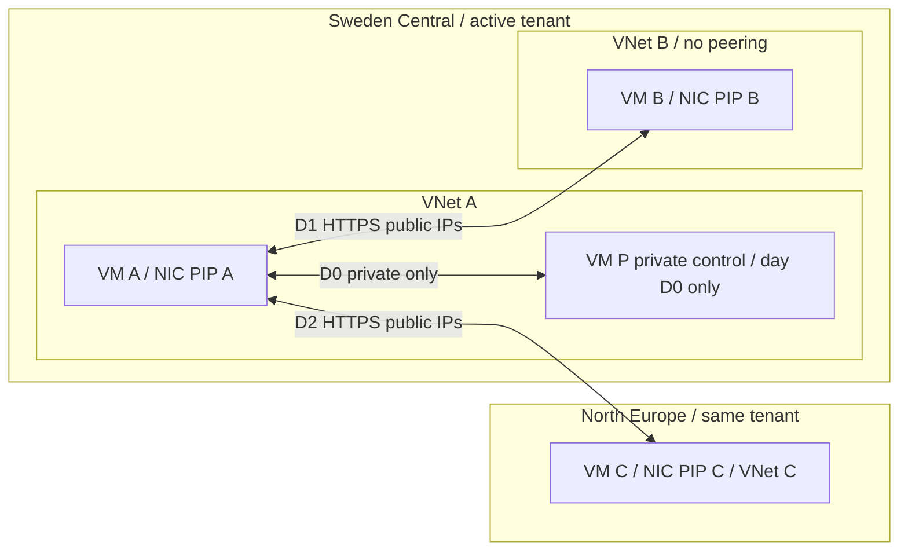

# Design: regional public-endpoint bandwidth classification

Research date: 2026-10-15. Scenario state: NOT RUN.
D0 A/B/P infrastructure is now deployed in Sweden Central and all three VMs
are deallocated. Executable guarded ARM lives in `deploy`; see
[deployment-log.md](deployment-log.md). C/NE and every traffic scenario remain
unrun. All inbound remains denied pending a separately approved mTLS harness.

## Supported answer and boundary

Same-region exemption is the leading hypothesis for a public-IP VM simulator.
The FAQ does not condition it on tenant ownership, but does not explicitly cover
every cross-tenant SaaS architecture. Verify regional placement and meters.
Public endpoint does not mean Internet egress. Front Door/CDN/anycast and provider
fees need separate analysis. Different subscriptions do not prove different tenants.

## Official sources and short quotations

All retrieved 2026-10-15. USD retail values are public list prices, not negotiated,
credit-adjusted, tax-inclusive or guaranteed account prices.

| Ref | Official source | Exact short quote / observed value | Meaning |
|---|---|---|---|
| S1 | [Bandwidth pricing](https://azure.microsoft.com/en-us/pricing/details/bandwidth/) | “Is data transfer between Azure services located within the same region charged?” / “No.” | Primary same-region exemption; FAQ does not specify tenant relationship or every frontend. |
| S1b | same | “Outbound data transfer is charged at the normal rate and inbound data transfer is free.” | FAQ answer for services in two regions. |
| S1c | same | “Between regions within Europe” / “$0.02 per GB” | Intra-continental inter-region list rate, each outbound direction. |
| S1d | same | “First 100 GB/Month” / “Free” | Internet-egress table; do not apply this allowance to inter-region pricing. |
| S1e | same | “From North America, Europe to any destination” / “$0.087 per GB” | First paid Internet tier, Microsoft network; ISP alternative $0.08/GB. |
| S2 | [Routing preference](https://learn.microsoft.com/en-us/azure/virtual-network/ip-services/routing-preference-overview) | “all traffic that goes to a destination within Azure continues to use the direct path within the Microsoft Wide Area Network.” | Even Internet-preference PIP does not force an Azure sink off-net. |
| S2b | same | “You can't change a public IP routing preference after creation.” | Optional routing A/B requires new PIP, not in-place toggle. |
| S3 | [Storage firewall limitations](https://learn.microsoft.com/en-us/azure/storage/common/storage-network-security-limitations) | “Services deployed in the same region as the storage account use private Azure IP addresses for communication.” | Public Storage DNS is not a generic VM public-IP routing control. |
| S3b | same | “IP network rules have no effect on requests that originate from the same Azure region as the storage account.” | Do not rely on a source PIP allowlist to secure this same-region Storage case. |
| S4 | [Storage routing preference](https://learn.microsoft.com/en-us/azure/storage/common/network-routing-preference) | “The default routing preference applies to all traffic from clients outside Azure” | Storage routing variants do not force intra-Azure traffic onto the Internet. |
| S5 | [App Service plans](https://learn.microsoft.com/en-us/azure/app-service/overview-hosting-plans) | “Only apps in the same App Service plan share the same VM instances.” | B1 has dedicated plan workers, not a single-tenant service stamp. |
| S6 | [ASE overview](https://learn.microsoft.com/en-us/azure/app-service/environment/overview) | “An App Service Environment is a single-tenant deployment of App Service that runs on your virtual network.” | True service-environment isolation, optional and expensive. |
| S7 | [Cost data](https://learn.microsoft.com/en-us/azure/cost-management-billing/costs/understand-cost-mgt-data) | “For pay-as-you-go subscriptions, it could take up to 72 hours” | No immediate zero-cost conclusion; credits excluded from consumption estimates. |
| S8 | [Cost Details API](https://learn.microsoft.com/en-us/azure/cost-management-billing/automate/get-small-usage-datasets-on-demand) | “only available for customers with an Enterprise Agreement or Microsoft Customer Agreement” | MSDN/Visual Studio need an offer-appropriate detailed path. |
| S9 | [Legacy offer details](https://learn.microsoft.com/en-us/azure/cost-management-billing/automate/get-usage-details-legacy-customer) | “The Cost Details API report isn't supported for your subscription type yet.” | MOSP/Visual Studio: Consumption details or approved Exports, not blind retries. |
| S10 | [VNet FAQ](https://learn.microsoft.com/en-us/azure/virtual-network/virtual-networks-faq) | “Data transfer across peering connections is charged.” | Peering/private link processing is not the same-region bandwidth exemption. |

## Four scenario families and priorities

Direction means **bulk-byte producer → consumer**, not necessarily TCP initiator.
Every row is two separate immutable transfer IDs, one per direction; JSON expands
these into directed scenarios with exact byte caps and producer attribution.

| Family / priority | IDs (suffix up/down) | Endpoint models / ownership | Hypothesis per bulk direction |
|---|---|---|---|
| F1 core / P0 | core-private-* | Same-VNet VM pair, same subscription and tenant, SC | No bandwidth transfer charge; negative control. |
| F1 core / P0 | core-same-* | VM A ↔ VM B, SC, unpeered separate VNets, same tenant/subscription, public | No bandwidth transfer charge, both directions. |
| F1 core / P0 | core-cross-* | VM A SC ↔ VM C NE, same tenant/subscription, public | Outbound producer quantity on inter-region Europe meter, ~$0.02/GB; receiver ingress free. Positive control. |
| F2 ownership / P1 | tenant-same-*, tenant-cross-* | Same VM endpoints, active + second subscription; **unequal tenantIds verified** | Same regional hypotheses as F1. Explicit tenant-specific test, not inference from login/subscription. |
| F2 ownership / P1 | subscription-same-* | Different subscriptions, equal tenantIds, SC | Same-region exemption; isolate subscription from tenant variable. Skip if no suitable approved subscription. |
| F3 service / P1 | paas-b1-same-*, paas-b1-cross-* | Regional App Service Linux B1 public app; same tenant initially | Same-region exemption; cross-region bulk producer emits charge, subject to actual PaaS meter attribution. Dedicated workers, shared multi-tenant stamp. |
| F3 service / P2 | paas-shared-* | App Service Free/Shared service-model comparison | Shared-worker quotas may prevent 5 GiB; preflight support, HTTPS and duration. Do not equate F1 shared workers with B1 or force an invalid SKU/OS combination. |
| F3 service / P3 | paas-ase-* | ASE v3 external public VIP, single-tenant environment | Compare regional exemption independently of ownership; deferred with full separate expensive resource/cost gate. |
| F4 path / P1 | storage-public-*, storage-service-*, storage-pe-* | Hot LRS Blob same region; public endpoint vs service endpoint vs PE | Intra-region bandwidth exemption; Storage operation/capacity and PE processing remain separately billable. |
| F4 path / P2 | routing-same-*, routing-cross-* | New Internet-preference Standard PIP, Azure sink | Still Azure WAN path per S2, same billing hypotheses; not an Internet-egress positive control. |
| F4 path / P2 | internet-owned-* | Explicitly owned non-Azure sink, no CDN/proxy | Azure-source Internet meter; first 100 GB allowance may hide paid cost/rows. Never transfer to an arbitrary public target. |

Optional families are outside the $8 gate. Infrastructure model and Entra
relationship are independent axes. Provider fees, cross-cloud, global edge,
replication and inter-zone variants are deferred. Pin SC VMs to a common supported
zone, or record placement and assess zone-related meters separately.

## Topology and three-VM scheduling

**Lean recommendation:** maximum three concurrent VMs; A+B in SC and a third
slot occupied by P in SC on D0, then P is deleted and C created in NE for D2.
This is **four lifecycle VM identities**, not falsely three VMs providing four
simultaneous placements. P has a private NIC only and uses A as controlled private
management/bootstrap relay; no implicit outbound. P resources are deleted before
C resources are created. B/C/P do no unrelated workload. All endpoints are newly
created lab resources; never share other labs' sources, NICs, PIPs or metrics.

| UTC billing day | Only large transfers | Producer/day isolation |
|---|---|---|
| D0 | A→P, P→A, private 5 GiB each | No public bulk scenarios; negative-control day. |
| D1 | A→B, B→A, public 5 GiB each | A and B have only same-region public bulk that day. |
| D2 | A→C, C→A, public 5 GiB each | A/C have only cross-region bulk that day. |

Allocate <=4 hours/slot/day, <=12 total. Deallocate between sessions; guest shutdown
is insufficient. Avoid midnight; abort if UTC-day window <30 minutes. Faults require
clean-baseline verification before advancing. Measure bootstrap/management and an
idle baseline separately. Daily meters cannot separate same-source/day bulk tests.
Account for ACK/TLS overhead, including reverse egress.

**Alternative:** four concurrent A/B/P/C avoid replacement, but still need three
UTC days because A is shared. Same-day isolation needs six VMs/NICs/disks, four
PIPs and four VNets (private pair shares one), dedicated RG per pair for RG-only
billing. Reprice/approve separately: roughly double compute/disk capacity.
Core's one-family/day also handles RG/day attribution, with overhead limitations.

## Transfer contract and decisive signals

1. Pre-test freeze: capture UTC, region, PIP/NIC/VM IDs, zone, tenant equality
   assertion, DNS answers, endpoint ownership, PIP routing preference, effective
   routes/NSGs and source address observed by receiver. Keep IDs private.
2. Single parallel stream of **5,368,709,120 payload bytes** per leg; total six
   legs 32,212,254,720 payload bytes (30 GiB), all wire directions <=35 GiB.
   Limit application rate to 20 Mbit/s, per-leg timeout 45 minutes, no automatic
   retry, total first-wave bulk window <=6 hours. 5 GiB takes ~36 minutes at
   20 Mbit/s. If credits/CPU cannot sustain it, abort rather than upgrade silently.
3. HTTPS on 443, pinned lab CA/cert and mutual client authentication. Service
   inbound NSG accepts only lab peer PIPs (private control private addresses).
   No unbounded/unauthenticated upload endpoint. Management 2222 only from approved
   operator IP, never 0.0.0.0/0; use private relay for P. Token/keys ignored.
4. Server enforces method/path, one-use transfer ID, maximum Content-Length,
   read/write deadline, 5 GiB upper bound and concurrency one. Disable HTTP
   compression, CDN/proxy and caching; use deterministic uncompressible generated
   stream, incremental SHA-256, sink discards content. Downloads generated on
   producer; uploads streamed, no large disk buffering. No retry amplification.
5. Append immutable transfer record on **both ends**: ID, scenario, UTC start/end,
   byte producer/consumer, declared/observed payload bytes, SHA-256, HTTP status,
   peer address, exit status, zero retries. Hash raw records locally. Corroborate
   with NIC/VM Network In/Out counters before/after and Azure metric intervals;
   metrics and traceroute are not billing evidence.
6. Enforce total **35 GiB combined wire counter cap**, including ACKs/bootstrap;
   reserve 5 GiB beyond payload. Stop at limit/time/error, remove listener and
   confirm no active transfer process. Do not retry without separately assigned
   bytes/day. Restore means no listener, baseline allowlists/routing and counters
   captured, producer idle; Niobe verifies before next scenario.

Transport PASS requires exact bytes/hash at both endpoints, expected peer, bounded
duration and no retry; otherwise transport FAIL/billing INCONCLUSIVE.
Billing verdict tests the **hypothesis**:
- Cross-region positive-control PASS requires mature **billable quantity >0**,
  expected inter-region outbound meter/unit/rate and attributable producer/day.
  Zero final cost is acceptable only with documented price/credit treatment.
- Free-allowance quantity without the expected paid-rate meter cannot pass control.
- Same-region/private hypothesis PASS requires transport PASS, mature successful
  positive control on the same offer/feed, complete details at adequate precision,
  no attributable charged transfer quantity, and overhead/allowance reconciliation.
  Absence of a row alone is not proof. With no explicit zero-rated row, qualify
  the result as “no charge observed under tested conditions,” not universal proof.
- Same-region hypothesis FAIL: attributable expected bandwidth quantity charged
  above bounded measured overhead, with verified regions/model and mature control.
  Capture meter and route; do not relabel all public traffic Internet egress.
- Missing positive control, unavailable quantity/rate, incomplete pages, unsupported
  offer, masking allowances, mixed resource/day attribution or feed still changing:
  INCONCLUSIVE (or BLOCKED before execution), never infer exemption from no rows.

Tolerance: 5% or 0.05 GB, whichever larger, versus measured wire bytes in the
documented meter unit. Unreconciled deviations are inconclusive, not a claim
about Azure's algorithm.

## First-wave resource and cost approval

Counts are peak concurrent; replacement P→C is separately enumerated lifecycle.
One new correlation-named RG; primary location SC, resources in SC and NE.
Tags on every supported resource: lab=true, created_by=copilot-lab, run_id.

| Resource | Count / placement | Configuration |
|---|---|---|
| Ubuntu VMs | 3 peak; A/B SC, third P SC then C NE; 4 identities total | Ubuntu 22.04 Gen2, SSH key only, no Spot, no paid image. |
| Managed OS disks | 3 peak, 4 lifecycle | 30 GiB StandardSSD_LRS (32 GiB E4 billing tier); delete P disk before C. |
| NICs | 3 peak, 4 lifecycle | One per VM, source explicit outbound via PIP except private-only P. |
| PIPs | 3 peak: A/B SC, C NE | Static Standard IPv4, Microsoft network preference; no PIP for P. |
| VNets/subnets | 3 / 3 | A and P share VNet A; B in unpeered SC VNet B; C unpeered NE VNet C. |
| NSGs | 3 peak / 4 lifecycle | Per-NIC allowlists; default denies; replace P NSG with C NSG. |
| Other | 0 | No gateway, NAT, LB, Firewall, peering, private endpoint, monitoring workspace, paid storage account or Megaport. |

**Provisional ladder:** B1ls → B1s → B2ts_v2 → B2ls_v2 → B2s_v2; D2as_v5 →
D2s_v5 only after allowed B options fail. Keep required SC/NE regions. Budget
candidates SC B2ts_v2 / NE B1ls are not selections: check cheaper ranks first.
P uses cheapest viable SC rank. No accelerated networking needed. Validate
image/RAM/TLS throughput; 0.5 GiB may be insufficient. Reapprove upgrades/D-series.

**Price provenance:** [Azure Retail Prices API](https://prices.azure.com/api/retail/prices),
retrieved 2026-10-15, currency USD, Consumption; exclude Windows/Spot/Low Priority
and Cloud Services products. Filters: armRegionName, serviceName, armSkuName for
VMs; exact product/meter for disk and PIP.

| Item | Retrieved public rate / budgeting treatment |
|---|---|
| SC Standard_B2ts_v2, Virtual Machines Bsv2 Series | $0.0108/hour; effectiveStartDate 2023-09-01. |
| NE Standard_B1ls, Virtual Machines BS Series | $0.0057/hour; effectiveStartDate 2025-10-01. |
| SC E4 LRS Disk, Standard SSD Managed Disks | $2.40/month; operations $0.002/10K. Budget $3/month/disk including NE provisionally. |
| SC Standard IPv4 Static Public IP, IP Addresses | $0.005/hour. Budget $0.006/IP/hour including NE provisionally. |
| Europe inter-region | $0.02/GB per outbound producer (S1c). 10 GiB total cross-region payload ~10.74 decimal GB, ~$0.215 before overhead. |
| Worst traffic reserve | Charge all 35 GiB at $0.10/decimal GB => $3.76 reserve, despite mostly exempt/private traffic. No free allowance/credits assumed. |

Planning arithmetic: worst SC-like third slot compute 3×$0.0108=$0.0324/hour;
PIPs 3×$0.006=$0.018/hour; disks 3×$3/730=$0.01233/hour.
Subtotal $0.06273/hour; round infrastructure **$0.08/hour**, **$2/24 hours**.
With compute limited to 36 VM-hours: <=$0.389 compute + <=$1.296 PIPs over
72 hours + <=$0.888 disk over 72 hours + $0.50 disk-operation reserve +
$3.76 traffic reserve = **<$6.84**, rounded **$8 lifetime cap**.
Monthly-to-hour proration is a planning assumption; confirm billing units/minimums
and NE disk/PIP prices at the final approval. No taxes/exchange-rate guarantee.
Disk operations must remain bounded (stream rather than store payload); stop if
retail/account prices or operation estimates exceed reserve. Budget alerts are
delayed and are **not** a spend hard stop; scheduler/owner enforce hours and bytes.

Deploy 10–20 minutes plus bootstrap; ~36 minutes/leg, three UTC dates over <=72h.
Billing: 72h after last transfer plus day-7 follow-up, **not compute lifetime**.
Deallocate after each session; separately confirm cleanup, preferably after D2.
If confirmation is delayed, flag disk/PIP costs before 72h; never delete without
approval. Coordinator should arrange cleanup confirmation in advance.

## Staged gates / current preflight

1. **Design done:** official docs/prices read; account discovery succeeded,
   explicit subscription name supplied, identity/IDs not persisted. A pinned
   SC list-skus call exceeded its 35-second bound; no catalog result obtained.
   NE catalog was not reached in that design lease. Subsequent billing access
   passed with mandatory client-side filtering; see [preflight.md](preflight.md).
   Subsequent Tank D0 catalogue, ARM validation and actual provisioning passed;
   all A/B/P VMs were deallocated before return. No traffic inference.
2. **Read-only prerequisite lease:** verify offer type and scoped billing read
   using a tiny aggregate query filtered to this lab only (before creation, an
   empty/nonexistent lab RG is acceptable for permission smoke-test). Query success
   does not establish Cost Details support or quantity visibility. Test proper
   detailed endpoint/supported offer before spending. Require permissions for
   sender and receiver subscriptions in cross-tenant phases.
3. **Coordinator approval:** exact resources, regions, conditional SKU ladder,
   35 GiB wire-data cap, $0.08/hour infrastructure estimate and $8 lifetime
   spending envelope, daily schedule, cleanup confirmation path.
   No resource creation, provider registration or shared configuration changes
   before explicit approval.
4. **Tank deployment lease:** check STOP/lease, catalog/quota/policy; then create
   approved dedicated preflight RG for bounded live validation. Never borrow an
   unrelated RG. Capacity remains pending, not guaranteed by validation. Follow
   ladder within approved cost; otherwise reapprove. Finalize manifest only after
   both catalog/live gates.
5. **Niobe daily lease:** bounded tests/restore and prompt verdict. Separate
   read-only collection leases at 24/48/72h/day 7; no waiting/background agents.
6. **Confirmed cleanup:** preserve private inventory/tenant map, lifecycle UTC,
   transfer/metric evidence and meter map. Preview, confirm, delete only tagged
   created inventory, verify deletion. Retain billing access after deletion (S7);
   private evidence 90 days/owner policy, signed URLs only until expiry.
