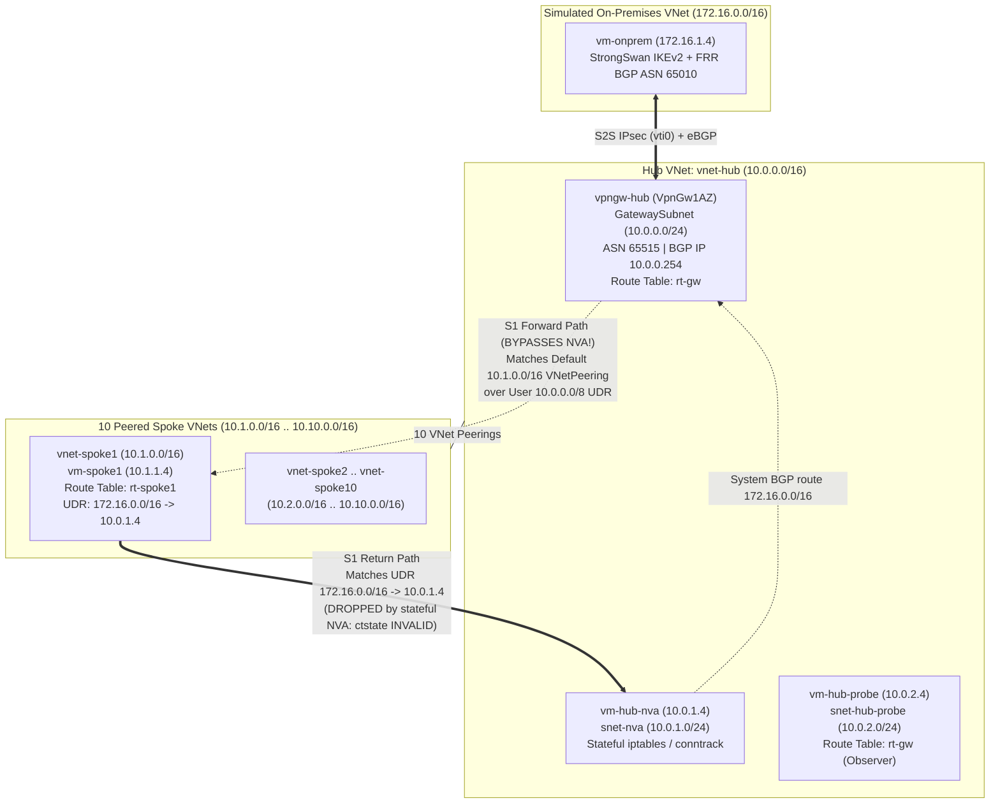
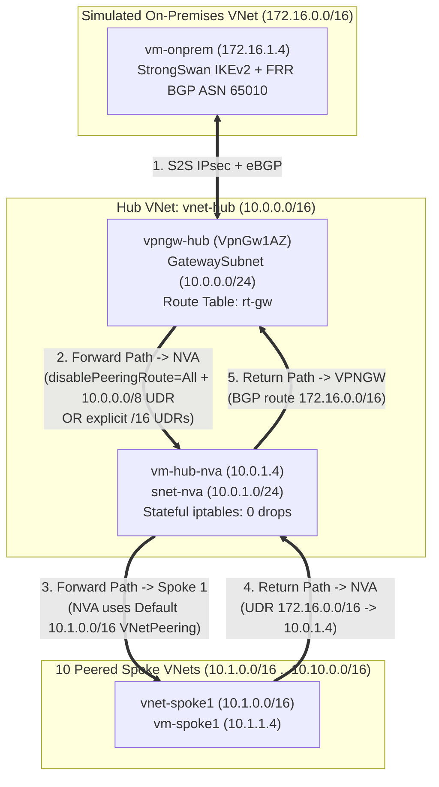

# Architecture & Packet Flow Diagrams

## 1. Topology & Scenario S1 (Asymmetric Bypass when `disablePeeringRoute = None`)

## 2. Scenario S2 (Symmetric NVA Routing when Peering Routes Are Suppressed/Overridden on `rt-gw`)

