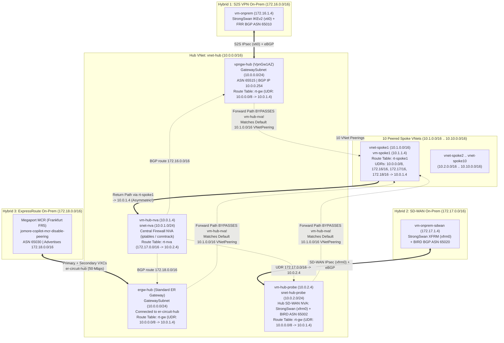
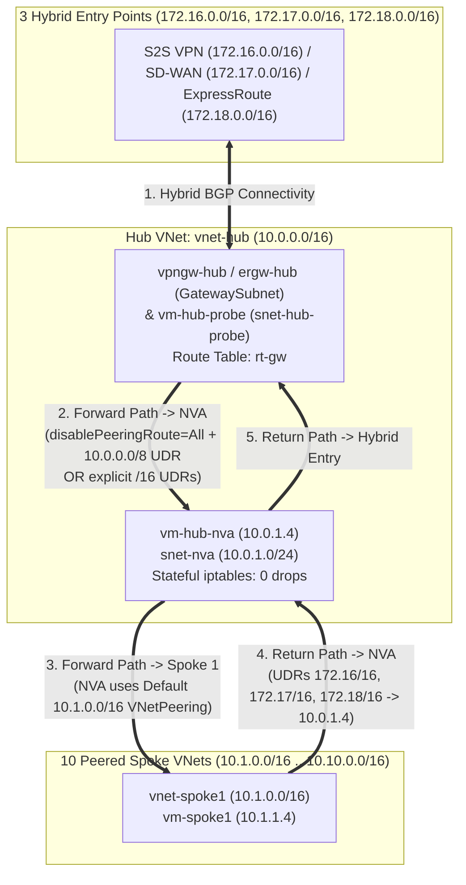

# Architecture & Packet Flow Diagrams

## 1. Expanded 3-Hybrid-Connection Topology & Asymmetric Bypass (`disablePeeringRoute = None` with Summary `10.0.0.0/8` UDR)

## 2. Scenario S2 (Symmetric NVA Routing when Peering Routes Are Suppressed/Overridden on `rt-gw`)

