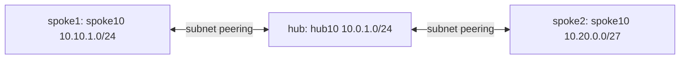

# Subnet peering with overlapping excluded spoke ranges

**PASS — subnet-peering control plane and NAT HTTP data plane (2026-10-16,
Sweden Central).** Two spokes
reused `192.168.0.0/16` while only their distinct 10.x subnets participated
in hub peering. All **four directed peerings** returned
`peeringState=Connected` and `provisioningState=Succeeded`, independently
validated. The five-VM extension also proves HTTP to both overlapping
backends through distinct NAT aliases, not general connectivity or a universal
overlap guarantee. [Latest verification][nat-verification] completed at
**2026-10-16T08:34:37Z**; this offline report was updated at
**2026-10-16T08:37:59Z** without rerunning Azure or VM tests.

## Cleanup completed

At Jose's explicit request, `rg-subnet-overlap-20261016-fde5ecf8` was
deleted on **2026-10-17**. Authenticated resource-group GET and scoped resource
inventory checks confirmed absence at **2026-10-17T09:25:05Z**; see
[cleanup verification](show-output/cleanup-corrected-20261017T091507Z/cleanup-verification.json).
The deleted inventory contained five VMs, five NICs, five disks, three VNets,
five lab-owned NSGs and eight VM extensions. No resources outside this group
were changed. The published post and captured evidence were preserved.

## Comprehensive capture and published post

Niobe captured a fresh, self-contained
[78-file evidence bundle](show-output/nat-evidence-20261016T085133Z/verification.json)
on 2026-10-16. It binds Azure and guest/IMDS identities to both backend IPs,
captures all five NIC route tables and guest configurations, and corroborates
the hub HTTP results with NAT counter deltas and backend logs.
The complete bundle is also included alongside Kid's
[published post](https://github.com/erjosito/azure-networking-blog/tree/main/2026-10-subnet-peering-overlapping-spokes).
The post distinguishes the tested topology from a conceptual transit-VNet
comparison and treats peering savings as conditional data-transfer savings,
not a fixed charge per peering link.

## Deployment at test time (subsequently deleted)

Redeployed on 2026-10-16 at Jose's request in **Sweden Central**.
The resource group contained the `hub`, `spoke1`, and `spoke2`
VNets and all four directed subnet peerings; every peering
returned **Connected / Succeeded**. Exact prefixes and subnet selectors were
unchanged.
The initial retained network run submitted eight PUTs and zero DELETEs; see
[retention proof][retained]. The subsequent VM deployment added five NICs,
five VMs and their OS disks; it did not change the peerings.
The original cleanup evidence below belongs to the earlier test; the final
2026-10-17 cleanup proof is linked above.

All **five VMs were Running** during capture, with **Standard_D2als_v6**, Ubuntu 22.04 Gen2
and **30 GB Standard SSD (`StandardSSD_LRS`)** OS disks; see
[deployment readiness][readiness]. This VM generation was selected for
subnet-peering hardware compatibility per [Microsoft Learn][learn], rather
than assuming any low-cost VM generation is compatible.
Expected retail cost while running was approximately **$10.7145/day**,
**not measured billing**. These resources no longer exist.

| VM | Role | Primary private IP | Secondary NAT alias |
|---|---|---|---|
| vm-hub-hub10 | HTTP client | `10.0.1.4` | — |
| vm-spoke1-spoke10 | NVA1 | `10.10.1.4` | `10.10.1.10` |
| vm-spoke2-spoke10 | NVA2 | `10.20.0.4` | `10.20.0.10` |
| vm-spoke1-isolated192 | Backend1 | `192.168.1.4` | — |
| vm-spoke2-isolated192 | Backend2 | `192.168.1.4` | — |

## Tested topology

| VNet | Full VNet address prefixes | Selected subnet | Excluded subnet |
|---|---|---|---|
| hub | `10.0.0.0/16` | hub10: `10.0.1.0/24` | none |
| spoke1 | `10.10.0.0/16`, `192.168.0.0/16` | spoke10: `10.10.1.0/24` | isolated192: `192.168.1.0/24` |
| spoke2 | **`10.20.0.0/26`**, `192.168.0.0/16` | spoke10: `10.20.0.0/27` | isolated192: `192.168.1.0/24` |

Both spokes retain the excluded range; no spoke-to-spoke link was created.
Spoke2's parent **/26 was preserved**, not widened to /16.

## NAT HTTP result and observed routes

**No UDRs, no public IPs and no peering changes.** Each alias is configured
both as an Azure NIC secondary IP configuration and a guest address.
Static DNAT maps traffic from hub `10.0.1.4` addressed to the respective alias
to that spoke's `192.168.1.4`. Selective SNAT changes the source to the
respective NVA primary (`10.10.1.4` or `10.20.0.4`), giving a symmetric
return through that NVA; conntrack reverses the translations.

At **2026-10-16T08:33:28Z**, [hub HTTP proof][http] recorded **3/3 HTTP 200**
responses per alias on **TCP 8080**, with exact distinct bodies:
`spoke1-backend-192.168.1.4` and `spoke2-backend-192.168.1.4`.
On **each NVA**, DNAT and SNAT counters each increased **+3**; request and
reply FORWARD counters each increased **+15** ([counter deltas][nat-verification]).
Only this HTTP path is proven: other TCP ports, ICMP, direct hub-to-backend
connectivity, isolation and transitivity were not verified.

All five Azure NIC effective-route tables were collected. The compact subset
below comes from the actual raw tables, **not an expected-connectivity matrix**.
Each listed route has **state `Active`** and source `Default`; next-hop IP
arrays are empty. Full tables are linked in the NIC column.

| NIC (VM name + `-nic`) | Local prefix → nextHopType | Peered prefix → nextHopType | Best match for `192.168.1.4` → nextHopType |
|---|---|---|---|
| [vm-hub-hub10][route-hub] | `10.0.0.0/16` → `VnetLocal` | `10.10.1.0/24`, `10.20.0.0/27` → `VNetPeering` | `192.168.0.0/16` → `None` |
| [vm-spoke1-spoke10][route-nva1] | `10.10.0.0/16`, `192.168.0.0/16` → `VnetLocal` | `10.0.1.0/24` → `VNetPeering` | `192.168.0.0/16` → `VnetLocal` |
| [vm-spoke1-isolated192][route-backend1] | `10.10.0.0/16`, `192.168.0.0/16` → `VnetLocal` | `10.0.1.0/24` → `VNetPeering` | `192.168.0.0/16` → `VnetLocal` |
| [vm-spoke2-spoke10][route-nva2] | `10.20.0.0/26`, `192.168.0.0/16` → `VnetLocal` | `10.0.1.0/24` → `VNetPeering` | `192.168.0.0/16` → `VnetLocal` |
| [vm-spoke2-isolated192][route-backend2] | `10.20.0.0/26`, `192.168.0.0/16` → `VnetLocal` | `10.0.1.0/24` → `VNetPeering` | `192.168.0.0/16` → `VnetLocal` |

**Surprise:** both excluded backend NICs expose an active hub
`10.0.1.0/24` peering route. Learn's subnet-peering limitations document
forward-route visibility on nonpeered subnets; **route visibility does not
prove usable connectivity**. The hub's best match for the overlapping backend
is instead `192.168.0.0/16` → `None`; the proven HTTP path uses the unique aliases.

## Reproduction contract

See [locked design and REST recipe](design.md), the persisted
[five-VM executor](deploy/nat_deploy.py) and [ARM template](deploy/nat-template.json).
The adjacent `deploy/nat-spec.json` records addresses and image selection;
the template persists guest alias, forwarding and NAT bootstrap configuration.
The design's pending-status text is
historical; the completed evidence below supplies the result.
Use a fresh approved lease/account check for any rerun; do not reuse a completed
lease. The tested deployment was retained until explicit cleanup approval
on 2026-10-17. No deployment is needed to inspect this report.

Create the exact VNets/subnets above, then PUT hub/to-spoke1,
spoke1/to-hub, hub/to-spoke2, spoke2/to-hub using REST API **2026-01-01**.
Every request uses `peerCompleteVnets=false`; hub-side
`localSubnetNames=["hub10"]`, `remoteSubnetNames=["spoke10"]`;
reverse requests swap those lists. These are **subnet names**, not CIDRs.
Set `allowVirtualNetworkAccess=true`; forwarding, gateway transit,
remote gateways and IPv6-only peering are false.
GET all four and the parent VNets before any separately authorized cleanup.

Provider preflight checks Registered `Microsoft.Network` and API support on
parent `virtualNetworks`; a separate child-peering metadata entry is not
required. The first peering PUT gates feature/enrollment capability; an
auth/allowlist/API rejection is not evidence of overlap failure.

## Original test evidence and historical cleanup

- [Original control-plane PASS verdict][verdict]. Its adjacent
  `peerings-final.json`, `vnets-final.json` and `resource-inventory.json`
  preserve the original peerings, subnet definitions and inventory.
- [Restore proof][restore]: one scoped RG deletion, authenticated absence at
  **2026-10-16T07:04:41Z**.
- [Independent validation][independent]: PASS; authenticated
  `ResourceGroupNotFound` **404 at 2026-10-16T07:08:05Z** confirmed cleanup.
  Inventory: one RG, three VNets, five inline subnets, four directed peerings;
  no task resources remained after that original run. The subsequent retained
  deployment above recreated them.

Final GETs were sequential, **not an atomic snapshot**; no intervening writes,
and later parent VNet GETs corroborated them before deletion. **In that original
control-plane-only run**, no VMs, packet probes, effective routes, isolation
or transitivity were tested. The later five-VM NAT HTTP and route results above
supersede that limited scope, not the historical cleanup evidence.
The name `isolated192` is not proof of isolation.
Expected control-plane-only cost was **$0** (no compute or generated peering
traffic); billing was not measured, so this is not a billed-zero assertion.

[verdict]: show-output/subnet-overlap-acceptance-20261016-7149289d-f221-46ea-9d49-4b55eac48964/verdict.json
[restore]: show-output/subnet-overlap-acceptance-20261016-7149289d-f221-46ea-9d49-4b55eac48964/restore.json
[independent]: show-output/independent-validation-20261016/verification.json
[retained]: show-output/subnet-overlap-retained-20261016-c84d66d6-c7a8-4bbd-a567-26d056d0b983/no-delete-proof.json
[nat-verification]: show-output/nat-validation-20261016T083150Z/verification.json
[http]: show-output/nat-validation-20261016T083150Z/hub-http-proof.json
[readiness]: show-output/nat-vm-deploy-20261016T081847Z/readiness.json
[route-hub]: show-output/nat-validation-20261016T083150Z/routes-vm-hub-hub10-raw.json
[route-nva1]: show-output/nat-validation-20261016T083150Z/routes-vm-spoke1-spoke10-raw.json
[route-backend1]: show-output/nat-validation-20261016T083150Z/routes-vm-spoke1-isolated192-raw.json
[route-nva2]: show-output/nat-validation-20261016T083150Z/routes-vm-spoke2-spoke10-raw.json
[route-backend2]: show-output/nat-validation-20261016T083150Z/routes-vm-spoke2-isolated192-raw.json
[learn]: https://learn.microsoft.com/en-us/azure/virtual-network/how-to-configure-subnet-peering
