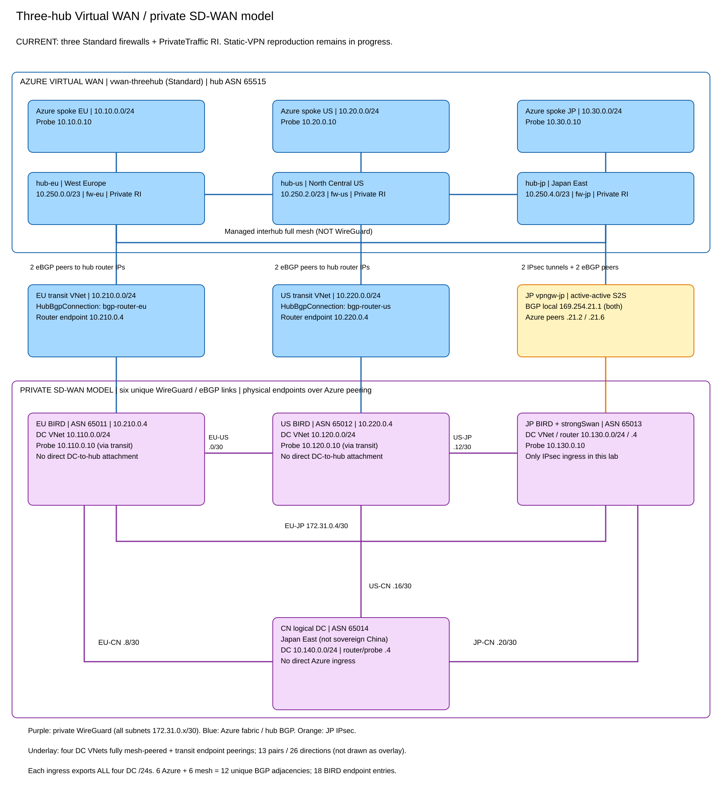
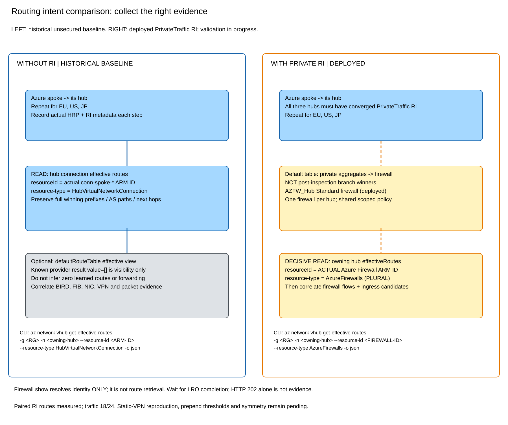

# Three-hub Virtual WAN / SD-WAN lab

> **2026-10-17: all-hub B2B rerun now includes workload traffic and packet-interface observations.**
> **Three Standard Azure Firewalls and PrivateTraffic routing intent are deployed.**
> **A:** ASPath plus NVA import policy selected Microsoft's backbone.
> **B1:** ExpressRoute HRP retained the longer local Japan paths after a controlled VPN-prefix withdrawal/re-advertisement.
> **B2:** ASPath with no extra nonlocal prepends selected local customer-mesh paths at the hub firewalls and NVAs.
> A/B1/B2 now have matched **42-direction TCP/ICMP matrices**. None is an all-pairs forwarding success.
> All ten VMs are back to their original **deallocated** states. Hubs, firewalls and VPN gateway remain deployed and billable.

## Latest result: all-hub B2B rerun with forwarding evidence

The [complete rerun report](show-output/b2b-summary-20261017/README.md)
contains fourteen measured states, full three-hub firewall tables, full
four-router BIRD configurations/routes and packet-interface observations.
Every state measures all 42 initiated directions between four DC and three
Azure-spoke endpoints, using source-bound private TCP/HTTP and ICMP.

| State | TCP passes / 42 | ICMP passes / 42 |
| --- | --- | --- |
| Original mixed hub B2B flags | 28 | 32 |
| All hub B2B flags enabled, no other policy change | 28 | 32 |
| A, NVA policy only | 36 | 36 |
| A, plus Japan workload UDR | 38 | 40 |
| B1, ExpressRoute, original three prepends, initial / withdrawn / returned | 28 | 32 |
| B1, EU two-prepend control, initial / withdrawn / returned | 30 | 33 |
| B1, VPN HRP | 32 | 34 |
| B2, ASPath with zero extra EU/US prepends | 36 | 36 |

Enabling Japan's per-hub flag changed **neither the twelve DC-prefix firewall
winners nor any traffic outcome** in the matched baseline. The WAN flag
was already enabled. The original flags were EU/US `true`, Japan `false`.

**B1's history dependency persists with all hub flags enabled:** initial
remote Japan length three, local length five after the JP-only direct
export withdrawal, and local length five retained after return. The
separate EU four-versus-three control repeats it. The inconsistent flags
therefore do not explain away that result. VPN HRP is now measured too,
but sequential route history prevents a universal ER/VPN comparison.

**Reachability does not prove the intended backbone.** Packet observations
did not establish Japan NVA/XFRM traversal for A's successful policy-only
EU/JP DC traffic. The peered underlay and workload steering remain relevant.
BIRD kernel-export `!` flags also remain. With A's UDR, EU/US DC -> Japan
workload fails TCP/ICMP; the reverse fails TCP. B2's six failures are the
Japan workload <-> three Azure spokes. All failures remain explicit.

Exact BIRD bytes/metadata, original mixed HRPs/flags and paired firewall
winners were independently restored and verified. The original traffic
matrix also repeated. All ten VMs are again deallocated; the temporary
A route table was deleted and the original subnet association verified.
No IPsec or WireGuard configuration was changed.

## Earlier result: why the ExpressRoute-HRP controls differed

The [17 October route-history control](show-output/hrp-reselection-control-20261017/README.md)
used the original **three-extra-prepend** EU/US configuration without changing
it. After switching from the saved mixed HRPs to all-hub ExpressRoute,
EU/US initially retained Japan's remote path, length three. Withdrawing
only Japan's direct Azure export of `10.130.0.0/24` made their local NVA
paths, length five, win. After restoring that export, **the longer local
paths remained selected at both hubs**, reproducing the intended B1 behavior.

All four BIRD configuration files and metadata, and all three HRPs, were
identical before and after the withdrawal/re-advertisement. This establishes
**history-dependent selection**, not a general inability to prefer local
peered-NVA routes. It also confirms that the local routes were eligible.
The original three-prepend paths are two ASNs longer than the remote path,
within the documented race-condition warning. That does not retroactively
explain the separate 16 October two-prepend, one-ASN-difference control or
identify Azure's internal mechanism.

A [separate one-ASN-difference control](show-output/hrp-one-asn-control-20261017/README.md)
then reproduced the same history dependency with EU's local path length
four versus the remote length three. The local path remained selected after
Japan's direct export returned, despite identical EU configuration and HRP
before and after. Thus the observation is not limited to the documented
two-longer condition. Its internal cause still requires Azure backend
investigation; the older negative verdict remains preserved.

The [scenario verdict](show-output/hrp-reselection-control-20261017/reselection-verdict.json),
[independent exact reset](show-output/hrp-reselection-verify-20261017/verification-verdict.json)
and [original power inventory restoration](show-output/hrp-reselection-power-20261017/power-verdict.json)
all passed. No IPsec, WireGuard, mesh-export, workload-subnet or traffic-test
changes were made.

## A or B: which backbone should carry the traffic?

The [A/B design comparison](show-output/ab-design-comparison-20261016/README.md)
organizes the measured states around the operational choice: **A, Microsoft
backbone preferred**, or **B, customer backbone preferred**. It links matched
EU/Japan firewall tables and EU/Japan/China NVA configurations and routes for
A, B1 and B2. US is collected as well.

The earlier 16 October B1 control used all-hub ExpressRoute HRP and two extra nonlocal prepends at EU/US.
Their local Japan path had four ASNs versus three on the remote VPN path;
both firewalls still selected the remote path. This does not reproduce the
intended B1 design, and the result must not be presented as successful
HRP-only customer-backbone preference. VPN HRP was not measured.

B2 used all-hub ASPath HRP and removed EU/US extra nonlocal prepends. The
local two-ASN Japan paths won at EU/US; Japan selected its local VPN ingress
for the EU prefix. NVA mesh selections passed the customer-first assertions.
Its original run records **BLOCKED** because the lease expired during
read-only restoration proof, after the restore commands completed.
The subsequent [independent recovery verification](show-output/ab-final-recovery-verification-20261016/verification-verdict.json)
passed exact source/metadata, original mixed HRPs and paired firewall winners.
[Power restoration](show-output/ab-router-power-restore-20261016/power-restore-verdict.json)
returned only the four routers started for these controls to their saved
states; all six probes were untouched.

## Latest result: two routing decisions, not one

The [matched three-state report](show-output/backbone-policy-design-20261016/README.md)
compares the current user-configured baseline, ASPath plus NVA policy, and that
same policy plus a temporary Japan workload UDR. Every state includes firewall
effective tables, full BIRD configuration, selected routes, kernel routes and
seven directional TCP/ICMP cells.

At baseline, EU/US firewalls already selected the remote Japan VPN route
`65520-65520-65013`, but their NVAs selected `mesh_jp` with path `65013`.
After accepting foreign DC routes from Azure and assigning Azure imports
local-pref 400, EU/US NVAs selected `azure_*` with path
`65515-65520-65520-65013`. Japan selected EU DC and spoke routes through Azure
too. This demonstrates why HRP and outbound prepends alone do not select the
NVA's DC-to-Azure forwarding path.

The [independent final verification](show-output/backbone-final-verification-20261016/verification-verdict.json)
preserves the user's exact EU/US prepended BIRD files, original Japan/China
files and metadata, mixed HRPs (EU/US ASPath, Japan ExpressRoute), eighteen
Established BIRD endpoints, two Japan IKE SAs and original paired firewall
winners. The temporary route table was deleted and Japan's original subnet
association restored. [Power restoration](show-output/backbone-power-restoration-20261016/power-restoration-verdict.json)
returned only the ten VMs started for this request to deallocated.

## Objective and result so far

Measure **Azure → DC** route selection at **each** hub as the outbound DC
AS path is prepended at one ingress, comparing `ExpressRoute`, `VpnGateway` and
`ASPath` hub routing preference (HRP), first unsecured and then with
PrivateTraffic RI. There is **no ExpressRoute circuit**: ExpressRoute here
is the policy name; `VpnGateway` is the ARM value for the portal's VPN option.
Separate DC → Azure controls and bidirectional traffic
are needed to establish directionality/symmetry. No throughput claim is intended.

| Evidence | What it establishes / does not establish |
| --- | --- |
| [B0 baseline verdict](show-output/b0-unsecured-er/baseline-verdict.json), 2026-10-14 | **FAIL**: TCP and ICMP each passed **10/24 directional cells** (5/12 each direction), not a successful forwarding baseline. One connection-effective snapshot exposed twelve winners; stable/losing-path proof was insufficient. Packet capture truncation prevented symmetry/no-bypass claims. This is earlier baseline evidence, **not current forwarding health**. |
| [Partial unsecured ASPath/JP sweep](show-output/unsecured-aspath-jp/sweep-verdict.json) | **INCONCLUSIVE**: counts 0–3 and restore0 had paired stable twelve-winner snapshots; no switch through 3. Count 4 was not measured in that run. No forwarding claim. |
| [Latest ASPath boundary verdict: JP VPN versus EU peered-NVA](show-output/vpn-sdwan-aspath-boundaries/sweep-verdict.json), 2026-10-15 01:11 UTC | Overall **BLOCKED**, `restored: false`; only `baseline0`, `jp-add4`, `jp-add8` completed. These ASPath/no-RI control-plane states were stable with no JP winner change at sampled +4/+8 across twelve observer/prefix combinations. EU sweep did **not** run. The lease stopped/expired; failed restore/snapshot handling prevents acceptance of the run. No finite minimum threshold, successful recovery, or data-plane result follows. |
| [Post-restart recovery verification](show-output/restored-mesh-verification/verification-summary.json), 2026-10-15 08:40 UTC | **PASS**: eighteen Established BIRD endpoint entries, corresponding to six unique mesh and six Azure-facing adjacencies; two Japanese IKE SAs; all four DC exports on both Azure peers at EU, US and JP. Two observations at least 174 seconds apart, original BIRD identities preserved, and marked outer transport routing verified. Hub winners and forwarding were not queried in this recovery check. |
| [Europe +8 / HRP comparison](show-output/unsecured-hrp-comparison-20261015/comparison-verdict.json), 2026-10-15 | Overall **INCONCLUSIVE**. Fresh zero-prepend and EU +8 ASPath/no-RI states each had twelve stable winners in paired snapshots. All hubs continued to select their local ingress, including EU with eight additional ASNs. EU was restored exactly and all four routers passed source/protocol closure. A subsequent EU effective-route query timed out; paired restored winners and the Vpn/ExpressRoute comparisons were not completed. |
| [Sleep recovery](show-output/sleep-recovery-20261015-1350/recovery-verdict.json), 2026-10-15 | **PASS**: a CN-only withdrawal had remained active on Japan after an interrupted experiment. The protected original Japan BIRD file and exact metadata were restored. All four original hashes, eighteen Established protocol endpoints, both Japan IKE SAs, and identical four-prefix exports on both Azure peers passed closure. No forwarding or hub-route claim. |
| [Post-sleep HRP comparison](show-output/unsecured-hrp-after-sleep-20261015/comparison-verdict.json), 2026-10-15 | **INCONCLUSIVE**, `restored: true`: paired ASPath baseline and final restored winners passed, with exact four-router source closure. The VPN case was rejected because the controller used `Vpn` instead of the documented `VpnGateway` ARM value. The controller is corrected; this rejection is not a VPN routing result. |
| [Supported-enum retry](show-output/unsecured-supported-hrp-enums-20261015/comparison-verdict.json), 2026-10-15 | **BLOCKED**: another laptop sleep expired the lease during the read-only baseline. Zero mutations occurred and no preference comparison completed. The finalizer now persists this status even after expiry. `restored: false` means closure was not completed; it does not imply that this run changed the configuration. |
| [Exact-prefix withdrawal control](show-output/exact-cn-alternative-control-20261015/eligibility-verdict.json), 2026-10-15 | **PASS**, `restored: true`, `remoteCNEligible: false`: withdrawing only CN `10.140.0.0/24` from both Japan Azure exports removed that prefix from Japan's spoke-effective routes in two stable snapshots. EU and US retained their local CN winners. Japan's original file/metadata/exports, the twelve original winners and all four router sources/protocols were restored. This is a negative eligibility result, not proof of locality-first selection. |
| [Independent reset verification](show-output/exact-cn-reset-verification-20261015/verification-verdict.json), 2026-10-15 | **PASS**, zero mutations: fresh four-router source/export/protocol checks matched the original baseline; all hubs were ASPath/no-RI with their original per-hub branch-transit flags `false`. |
| [Branch-transit exact-prefix control](show-output/branch-transit-exact-cn-control-20261015/eligibility-verdict.json), 2026-10-15 | **PASS**, `restored: true`, `remoteCNEligible: false`: enabling `allowBranchToBranchTraffic` was accepted on all three hubs, but repeating the same CN-only withdrawal still left Japan without that prefix in both snapshots. The original hub flags, Japan file/exports, paired twelve-winner baseline and all-router source/protocol health were restored. Four bounded mutations; no IPsec, HRP or connection-label changes. The flag alone did not establish a remote competitor. |
| [Private routing-intent deployment](show-output/private-routing-intent-deployment-20261015/deployment-verdict.json), 2026-10-15 | **PASS**: three Standard hub firewalls and PrivateTraffic-only intent were deployed. Actual hub/firewall bindings and all three private next-hop policies were verified. No Internet RI or HRP/VPN configuration change; resources retained for secured testing. This is infrastructure acceptance, not replication of a static-VPN routing test. |
| [Firewall query discriminator control](show-output/firewall-resource-type-validation-20261015/probe-verdict.json), 2026-10-15 | **PASS**: the completed EU firewall query using **`AzureFirewalls` (plural)** exposed all four DC prefixes. The preceding secured collector used singular `AzureFirewall` and received empty responses; its route baseline was inconclusive and it ran no traffic probes. The helper and commands below are corrected. Empty responses to the wrong discriminator are not evidence of missing routes. |
| [Secured baseline with corrected firewall query](show-output/secured-firewall-supported-type-baseline-20261015/forwarding-verdict.json), 2026-10-15 | Route baseline **PASS**: twelve stable DC-prefix winners in paired firewall snapshots, all four original router source/export/protocol checks passed. Forwarding **FAIL**: TCP and ICMP each passed **18/24 directions**. All six failures are to/from Japan's workload probe `10.130.0.10`; all six CN-target directions pass. This uses ASPath HRP and the existing BGP VPN, not the static-VPN/ExpressRoute-preference reproduction. Zero configuration mutations. |

**Historical limitation of the 2026-10-15 withdrawal controls:** the same CN prefix is advertised locally at EU
and US, but neither controlled withdrawal demonstrated its remote availability
at Japan. Consequently, the earlier no-switch prepend observations cannot
establish an ASPath threshold or an unconditional preference for local routes.
The remaining HRP/prepend comparisons require a proven same-prefix remote
alternative. Those controls do not invalidate the later same-prefix remote
Japan winner above. The full forwarding matrix and static-VPN reproduction
remain unfinished; deployed firewalls alone do not establish that reproduction.

The historical restore attempt's `SNAPSHOT` failure remains a limitation of
that experiment, not a description of current guest health. The later fresh
recovery proof establishes the running mesh and original advertisements;
it does not retroactively complete the earlier experiment. Do not replay closed leases.
The [infrastructure handoff](infrastructure-handoff.json) records actual resource
bindings but contains historical guest failure/recovery fields; it is not a
current experiment acceptance certificate. The later
[implementation handoff](implementation-handoff.md) distinguishes guest
activation from scenario validation. A historical 18-entry Established smoke
snapshot alone is not current health; use the dated recovery verification above.

## Actual topology



[Editable topology](diagrams/topology.excalidraw) ·
[Editable RI comparison](diagrams/routing-intent.excalidraw) ·
[Diagram renderer](diagrams/render_diagrams.py)

All resources are in Azure Public. “China” is a **logical DC hosted in Japan
East**, not sovereign China and not a latency simulation. The locked regions
are **West Europe, North Central US and Japan East**; early candidate regions
in the design history are not the deployed locations.

| Site / role | Region | DC VNet / probe | Router endpoint / ASN | Transit VNet | Azure spoke / probe | Hub / ASN |
| --- | --- | --- | --- | --- | --- | --- |
| EU ingress | `westeurope` | `10.110.0.0/24` / `10.110.0.10` | `10.210.0.4` / **65011** | `10.210.0.0/24` | `10.10.0.0/24` / `10.10.0.10` | `hub-eu`, `10.250.0.0/23` / **65515** |
| US ingress | `northcentralus` | `10.120.0.0/24` / `10.120.0.10` | `10.220.0.4` / **65012** | `10.220.0.0/24` | `10.20.0.0/24` / `10.20.0.10` | `hub-us`, `10.250.2.0/23` / **65515** |
| JP ingress | `japaneast` | `10.130.0.0/24` / `10.130.0.10` | `10.130.0.4` / **65013** | None | `10.30.0.0/24` / `10.30.0.10` | `hub-jp`, `10.250.4.0/23` / **65515** |
| CN logical DC / combined router-probe | `japaneast` | `10.140.0.0/24` / `10.140.0.4` | `10.140.0.4` / **65014** | None | None | None; **no Azure ingress** |

### Three separate connectivity layers

1. **Azure Virtual WAN:** Standard `vwan-threehub`, WAN-level branch-to-branch
   enabled, three hubs with the managed **interhub full-mesh topology**.
   This topology alone is not evidence of route propagation: the per-hub
   `allowBranchToBranchTraffic` values were `false`; temporarily enabling them
   did not make the exact CN prefix available remotely in the control above.
   Five VNet connections:
   `conn-spoke-eu`, `conn-spoke-us`, `conn-spoke-jp`,
   `conn-transit-eu`, `conn-transit-us` under their respective hubs.
   Default association and `Default` label propagation; no custom/static hub
   routing policy in the unsecured baseline.
2. **Azure-facing routing:** EU/US routers are in **transit VNets**, not their
   workload DC VNets. Each uses a genuine peered-VNet **HubBgpConnection**
   (`bgp-router-eu/us`) to both dynamic hub router IPs: four eBGP adjacencies.
   This is **not integrated vendor SD-WAN `VPN_S2S_Gateway` semantics**.
   Only Japan uses IPsec: one `vpngw-jp`, site/link/`conn-dc-jp`, **two
   active-active tunnels and two BGP adjacencies**. JP uses local
   `169.254.21.1/32` for both sessions; Azure custom peers are
   `169.254.21.2` and `169.254.21.6`, through `xfrm41/42`.
   Neither JP nor EU/US DC workload VNets attach directly to a hub.
3. **Private SD-WAN model:** four DC VNets are fully mesh-peered; six private
   WireGuard links carry full-mesh eBGP between the four BIRD routers.
   EU/US physical endpoints are in transit VNets. Peering is only underlay,
   not transitive routing or permission to bypass the overlay. Linux/BIRD
   routes, UDRs and filters force remote DC traffic through the model.

There are **six Azure-facing adjacencies + six unique mesh adjacencies =
twelve unique BGP adjacencies**. The four routers report **18 BIRD entries**:
six Azure-facing endpoints plus twelve mesh endpoints (each mesh adjacency is
counted at both ends). **Not eighteen unique BGP adjacencies.** Managed Azure
interhub connectivity is separate from those BIRD counts.

### WireGuard / peering underlay

| Mesh pair | Tunnel subnet | First / second tunnel IP | Physical endpoint pair |
| --- | --- | --- | --- |
| EU–US | `172.31.0.0/30` | `172.31.0.1` / `172.31.0.2` | `10.210.0.4` / `10.220.0.4` |
| EU–JP | `172.31.0.4/30` | `172.31.0.5` / `172.31.0.6` | `10.210.0.4` / `10.130.0.4` |
| EU–CN | `172.31.0.8/30` | `172.31.0.9` / `172.31.0.10` | `10.210.0.4` / `10.140.0.4` |
| US–JP | `172.31.0.12/30` | `172.31.0.13` / `172.31.0.14` | `10.220.0.4` / `10.130.0.4` |
| US–CN | `172.31.0.16/30` | `172.31.0.17` / `172.31.0.18` | `10.220.0.4` / `10.140.0.4` |
| JP–CN | `172.31.0.20/30` | `172.31.0.21` / `172.31.0.22` | `10.130.0.4` / `10.140.0.4` |

**13 peering pairs / 26 directed peerings:** six among the four DC VNets;
DC-EU↔transit-EU and DC-US↔transit-US; transit-EU↔transit-US; and
transit-EU↔DC-JP/DC-CN plus transit-US↔DC-JP/DC-CN.
Access/forwarding are enabled; gateway transit/remote gateways are disabled
on these peerings. There is no DC↔spoke peering. The diagram suppresses
individual fabric peerings to distinguish them from the six overlay links.

WireGuard uses independent interfaces, `Table=off`, MTU 1380, and direct private
endpoint/listen UDP ports 51821–51826 (the six pairs in table order, identical
at both ends). Exact peer `/32` inbound and outbound NSG rules permit each
pair's port; no `TH_WG_IN`/`TH_WG_OUT` translation or inner private-data NAT.
The 2026-10-15 action Run Command migration persisted this configuration without
managed command resources or service restarts, but its initial acceptance **failed**
(6/12 mesh BGP entries established; Azure 6/6 and Japan IPsec 2 SAs preserved).
See `show-output/direct-action-mesh/verdict.json` and `closure-proof.json`;
transport was retained, not rolled back. Subsequent recovery found missing
live `fwmark 0x200` policy routing and an empty table 100 on all routers.
Reapplying the existing `/opt/threehub/network.sh` restored rule priority 100,
the physical-gateway default, and physical peer `/32` pins in **table 100**.
The fresh recovery check then passed; the cause of the missing policy remains
unproven. Ordinary workload routing must not pin CN's `.4` in the main table:
that address is both a transport endpoint and a workload destination.
Only marked outer transport uses the physical pins. EU/US workload UDRs point to their transit `.4`;
JP probe guest routes use its `.4` without a recursive shared-subnet self-UDR.
CN probes originate on the combined router `.4`.

### Advertisements and experimental interpretation

Every ingress (**EU, US, JP**) advertises **all four DC /24s** identically
to its two Azure peers. The mesh exports only each router's own DC prefix
and directly Azure-learned spoke prefixes; no overlay transit re-export.
Azure imports reject DC prefixes; Azure exports reject spokes/default/control
routes to prevent loops. The three Azure spoke prefixes remain distinct
from the four DC prefixes.

An outbound prepend **count N means N additional copies of the ingress ASN
before eBGP's automatic local-AS insertion**. At zero, EU's own DC path is
`65011`; its CN path is `65011 65014`. At +4 they become five `65011` copies,
and five `65011` copies followed by `65014`, respectively. Verify actual
outbound UPDATEs/exports; BIRD's pre-insertion view can differ from the wire.
Only one ingress is changed at a time, all four DC routes together; the
other ingress counts stay zero. Spoke-path manipulation is a separate
DC → Azure control, with overlay local preference equalized first.

LPM and static-route preference precede HRP. Documented ExpressRoute/VPN HRP
generally considers locality before path length; `ASPath` prioritizes path
length, with documented remote-ER exceptions. Remote hubs advertise their
**selected winners**, not every original candidate. Interhub advertisements
prepend **`65520 65520`**. The documented ER/VPN race when local paths are at
least two ASNs longer is a **hypothesis/control to test here**, not a universal
switch threshold or a guarantee of locality. This peered-NVA lab cannot
establish integrated-vendor or ER-failure semantics.

Report each result by **observer hub × DC prefix × actual HRP × RI state ×
ingress × additional count**. Repeated ties/ECMP need paired captures ≥120
seconds apart. No switch at sampled 0/4/8 is a bounded observation through the
tested range, **not infinity** or proof of every untested intermediate count.
A first observed +4 switch only brackets a minimum in 1–4; refine integers.
Do not reconstruct hidden Azure losing paths and label them raw evidence.

### Interpreting local-versus-remote prepend tests

The following are **documentation-backed expectations and acceptance controls**,
not completed additional lab results. No private correspondence, screenshots,
customer identifiers, or customer address plans are included in this report.

| Assertion or question | Assessment |
| --- | --- |
| A local BGP NVA can remain selected after its AS path becomes longer than a remote VPN path. | Consistent with ExpressRoute/VPN HRP, which generally considers locality before AS-path length. Those policy names do not require an ExpressRoute circuit to exist. |
| Does the hub always prefer local routes regardless of path length? | **No universal rule.** `ASPath` HRP compares path length before locality, subject to the documented remote-ExpressRoute exception. ExpressRoute/VPN HRP also has a documented convergence race when local paths are at least two ASNs longer. |
| Does a selected longer local path prove the shorter remote alternative was eligible? | **No.** Effective routes show selected winners, not every losing candidate. Remote routes for other prefixes do not prove an alternative for the target prefix. Withdraw only the target local advertisement, verify a completed remote winner for that same prefix, and restore before comparing prepends. |
| Does prepending repair an intentionally nonforwarding route injector? | Not by itself. If the injector remains selected and continues advertising, traffic can blackhole even while BGP is healthy. Route selection and actual reachability require separate verdicts. |
| Does any route-map prepend influence the hub's choice? | Only an **inbound** map acts before hub best-path selection. An outbound map modifies advertisements after selection and cannot choose the Azure-side forwarding path. Capture the map attachment, direction, match, and resulting path. |
| Is a statically configured VPN site prefix a static route in the virtual hub route table? | Not automatically. Record its actual origin; do not apply hub-static-route precedence merely because the S2S site does not run BGP. |

For each decisive comparison, preserve the exact target prefix and prefix length,
prove both Azure peer advertisements, read actual HRP on every hub, and compare
paired completed effective-route snapshots before, during, and after the change.
With private routing intent, query the owning firewall's effective routes and
verify the actual private routing policy on **all** participating hubs. A hub
table pointing to a firewall is not proof of the firewall's onward choice.

Use supported two-byte ASNs for a reproducible baseline. The documented
[NVA peering requirements](https://learn.microsoft.com/en-us/azure/virtual-wan/scenario-bgp-peering-hub)
and [route-map limitations and directions](https://learn.microsoft.com/en-us/azure/virtual-wan/route-maps-about)
must both be checked; route-map prepends have additional ASN restrictions.
An accepted or visible configuration outside documented support is not a clean
reference baseline. See the
[HRP selection algorithm and exceptions](https://learn.microsoft.com/en-us/azure/virtual-wan/about-virtual-hub-routing-preference)
for the distinction between policy expectations and measured outcomes.

## Effective-route collection: without and with routing intent



Use a fresh authorized read lease before collecting anything. Three firewalls
and PrivateTraffic RI are deployed. The **`AzureFirewalls` (plural)** resource
type was verified against the live EU firewall and returned all four DC
prefixes. The singular `AzureFirewall` parses locally but returned empty
completed responses: local CLI help acceptance is not service validation.
`--resource-type` is a free string; its help examples are non-exhaustive.

Use ARM IDs beginning `/subscriptions/...` for `--resource-id`, **not**
`https://management.azure.com/...`. Keep full JSON, not table-formatted output.
The implementation's [effective_routes.py](deploy/effective_routes.py)
uses the CLI's LRO poller and rejects results without a completed `value` list.
Known `defaultRouteTable` `value: []` responses are provider visibility
limitations, **not evidence of no routes**.

### PowerShell setup and actual per-step metadata

Run from this lab directory in PowerShell 7. Use a new output directory for
each step; set `$Step` to the real ingress/count/snapshot label. Do not assume
the HRP from a folder name or reuse metadata from a preceding step.

```powershell
$ErrorActionPreference = 'Stop'
$Rg = 'rg-vwan-sdwan-threehub-20261014'
$Sites = @('eu', 'us', 'jp')
$Step = 'replace-with-approved-step-and-snapshot'
$Out = Join-Path $PWD ("show-output\route-read-" + $Step)
New-Item -ItemType Directory -Path $Out -ErrorAction Stop | Out-Null
$Sub = az account show --query id -o tsv
if ($LASTEXITCODE -ne 0 -or !$Sub) { throw 'Subscription lookup failed' }

function Save-AzJson {
    param([string[]]$AzArguments, [string]$Path)
    $raw = & az @AzArguments --subscription $Sub --only-show-errors -o json
    if ($LASTEXITCODE -ne 0) { throw "Azure read failed: $Path" }
    $text = $raw -join "`n"
    $null = $text | ConvertFrom-Json -ErrorAction Stop
    [IO.File]::WriteAllText($Path, $text, [Text.UTF8Encoding]::new($false))
}

$HubIds = @{}
foreach ($Site in $Sites) {
    $Hub = "hub-$Site"
    $HubIds[$Site] = az network vhub show -g $Rg -n $Hub `
        --subscription $Sub --query id -o tsv
    if ($LASTEXITCODE -ne 0 -or !$HubIds[$Site]) { throw "Missing $Hub" }
    Save-AzJson @('network','vhub','show','-g',$Rg,'-n',$Hub) `
        (Join-Path $Out "$Site-hub.json")
    Save-AzJson @('rest','--method','get','--url',
        "https://management.azure.com$($HubIds[$Site])/routingIntent",
        '--url-parameters','api-version=2024-05-01') `
        (Join-Path $Out "$Site-routing-intent.json")
}
@{ step=$Step; capturedUtc=[DateTime]::UtcNow.ToString('o')
   subscription=$Sub; hubs=$HubIds } | ConvertTo-Json -Depth 10 |
    Set-Content (Join-Path $Out 'capture-metadata.json') -Encoding utf8
```

The full hub JSON preserves **actual** `hubRoutingPreference`, routing/provisioning
state and other properties. The RI collection GET preserves the actual policies
(an empty `value` is the no-RI observation, not a configured policy). A failed
metadata read stops the step; do not turn failure into an “RI off” assertion.
Also record configuration hashes, both-peer exports, prepend count, protocol
proof and collection UTCs per snapshot in the run manifest.

### Without RI: connection-effective winners at all three hubs

This is the explicit EU form (replace the subscription placeholder if running
this standalone example):

```powershell
az network vhub get-effective-routes -g 'rg-vwan-sdwan-threehub-20261014' `
    -n 'hub-eu' `
    --resource-id '/subscriptions/<subscription-id>/resourceGroups/rg-vwan-sdwan-threehub-20261014/providers/Microsoft.Network/virtualHubs/hub-eu/hubVirtualNetworkConnections/conn-spoke-eu' `
    --resource-type HubVirtualNetworkConnection -o json
```

Dynamic all-hub collection, after the setup above:

```powershell
foreach ($Site in $Sites) {
    $Hub = "hub-$Site"
    $ConnectionId = "$($HubIds[$Site])/hubVirtualNetworkConnections/conn-spoke-$Site"
    Save-AzJson @('network','vhub','get-effective-routes','-g',$Rg,'-n',$Hub,
        '--resource-id',$ConnectionId,'--resource-type','HubVirtualNetworkConnection') `
        (Join-Path $Out "$Site-spoke-effective.json")

    # Do not include defaultRouteTable in the decisive collector:
    # those optional provider queries previously stalled in this lab.
}
```

### With PrivateTraffic RI: FIREWALL effective routes at the owning hub

Three `AZFW_Hub` **Standard** firewalls, a scoped shared policy and PrivateTraffic
RI are deployed and their actual bindings have passed acceptance.
Do not collect the secured comparison until **all three** are converged.
Direct peered-NVA BGP in a secured hub **without RI is unsupported**:
firewall-only/mixed-RI states are bounded conversion interruptions, not baselines.
No InternetTraffic RI is part of this design.

Under RI the hub default table contains **private aggregates with a firewall
next hop**, not the post-inspection branch winners. The decisive query is
`get-effective-routes` **on the owning hub**, with the **actual firewall ARM ID**
and `--resource-type AzureFirewalls`. `az network firewall show` below only
resolves/verifies that ID; **it does not retrieve routes**.

After the same per-step setup/metadata capture:

```powershell
$FirewallList = az network firewall list -g $Rg --subscription $Sub -o json
if ($LASTEXITCODE -ne 0) { throw 'Firewall inventory read failed' }
$Firewalls = ($FirewallList -join "`n") | ConvertFrom-Json
foreach ($Site in $Sites) {
    $Hub = "hub-$Site"
    $Candidates = @($Firewalls | Where-Object {
        $_.virtualHub.id -ieq $HubIds[$Site]
    })
    if ($Candidates.Count -ne 1) { throw "Expected one firewall owned by $Hub" }
    $FirewallId = az network firewall show -g $Rg -n $Candidates[0].name `
        --subscription $Sub --query id -o tsv
    if ($LASTEXITCODE -ne 0 -or !$FirewallId) { throw "Missing firewall ID: $Hub" }
    Save-AzJson @('network','vhub','get-effective-routes','-g',$Rg,'-n',$Hub,
        '--resource-id',$FirewallId,'--resource-type','AzureFirewalls') `
        (Join-Path $Out "$Site-firewall-effective.json")
}
```

Preserve `value`, `addressPrefixes`, `nextHops`, `nextHopType`, `routeOrigin`,
`asPath` and all ECMP entries. Verify all four DC prefixes in **each** firewall's
completed response. Pair this with default/connection views for context,
BIRD/FIB/NIC/VPN evidence and correlated firewall flows. Routes alone do not
prove inspection, reachability or symmetric stateful forwarding. The firewall
query discriminator is live-validated; full paired secured comparisons remain
separate scenario evidence.

### Windows-safe REST equivalent and LRO caveat

For the **unsecured EU connection**, after setup:

```powershell
$BodyPath = Join-Path $Out 'eu-effective-request.json'
@{
    resourceId = "$($HubIds['eu'])/hubVirtualNetworkConnections/conn-spoke-eu"
    virtualWanResourceType = 'HubVirtualNetworkConnection'
} | ConvertTo-Json | Set-Content $BodyPath -Encoding utf8

az rest --method post `
    --url "https://management.azure.com$($HubIds['eu'])/effectiveRoutes" `
    --url-parameters 'api-version=2024-05-01' `
    --headers 'Content-Type=application/json' `
    --body "@$BodyPath" --subscription $Sub -o json |
    Set-Content (Join-Path $Out 'eu-effective-initial-response.json') -Encoding utf8
if ($LASTEXITCODE -ne 0) { throw 'Effective-routes POST failed' }
```

The body uses an **ARM ID**, not an HTTPS URL; query parameters are separate
arguments, avoiding Windows inline-`&` parsing. For RI, replace `resourceId`
with the discovered firewall ID, `virtualWanResourceType` with `AzureFirewalls`,
and POST to **that firewall's owning hub**.

**HTTP 202 is only acceptance, not route evidence.** Unlike the primary CLI
command, a one-shot `az rest` POST is not sufficient: capture response
`Location`/`Retry-After`, poll the returned URL under the lease deadline, and
save the completed HTTP 200 full `value` response. Missing headers/completion
or an empty initial stdout is **unavailable**, not zero routes. Prefer the
CLI LRO poller above; do not use `--no-wait`. REST API `2024-05-01` is an
explicit request version here, **not newly verified provider support**.
The current Learn reference redirects its older version view to `2026-01-01`;
record the actual accepted API version with each future collection.

## Deployment, safety and completion work

Resource group: `rg-vwan-sdwan-threehub-20261014`; run ID:
`20261014-threehub`. Inventory is nine VNets, three hubs, five VNet connections,
ten Ubuntu 22.04 VMs (four routers, three DC probes, three spoke probes),
ten bootstrap Standard PIPs, one JP VPN gateway/site/link/connection, NSGs/UDRs,
NICs/disks. CN combines router and probe. Routers/probes use `Standard_B2ts_v2`
in EU/JP and `Standard_B2als_v2` in US; JP is unzoned.

- [lab-card.md](lab-card.md): locked objective/address/cost/lease envelope.
- [design.md](design.md): routing contracts and six tunnel endpoint pairs;
  use the region corrections in the current handoff, not initial US candidates.
- [deploy/infra.py](deploy/infra.py): deterministic ARM generator and connection/
  peering layout (the generator is named `infra.py`, not `deployinfra.py`).
- [deploy/deploy.ps1](deploy/deploy.ps1) / [control.py](deploy/control.py):
  lease-guarded infrastructure phases; **not permission to redeploy**.
- [deploy/guest.ps1](deploy/guest.ps1) / [guest.py](deploy/guest.py):
  separate stage/activate/smoke/restore lease.
- [recovery-handoff.md](recovery-handoff.md): recovery prerequisites.
- [deploy/cleanup.ps1](deploy/cleanup.ps1): separate bounded, confirmed cleanup
  lease; verify exact RG ID and run/owner tags, delete only created lab resources
  and verify absence. **Cleanup has not happened.** No cleanup command was run
  for this documentation task.

`deploy\.runtime-control\` contains ignored runtime leases, PSKs, generated
WireGuard private keys and protected guest artifacts. **Never copy them into
the report, diagrams or source control.** Bootstrap public IPs are not public
management endpoints; use authorized Run Command. Do not publish raw captures
or credentials. Sanitized completed route JSON is published in `show-output`.

Remaining gates: fresh owner/lease and paired restored hub winners after the
latest collector timeout; a passing
forwarding baseline and anti-bypass/symmetry evidence; complete per-HRP,
per-ingress/refined-boundary sweeps; approved all-hub RI deployment and
firewall-effective comparison; exact zero-prepend/config restore; then
tag-scoped cleanup. Progress is published to the existing repository at the
user's request; no separate public repository or blog is created.

### Official references

- [Hub routing preference and interhub AS paths](https://learn.microsoft.com/en-us/azure/virtual-wan/about-virtual-hub-routing-preference)
- [Routing intent / private routing policies](https://learn.microsoft.com/en-us/azure/virtual-wan/how-to-routing-policies)
- [Direct peered-VNet BGP](https://learn.microsoft.com/en-us/azure/virtual-wan/scenario-bgp-peering-hub)
- [Effective routes fields](https://learn.microsoft.com/en-us/azure/virtual-wan/effective-routes-virtual-hub)
- [Virtual Hubs — Get Effective Virtual Hub Routes REST](https://learn.microsoft.com/en-us/rest/api/virtualwan/virtual-hubs/get-effective-virtual-hub-routes)

Local documentation validation: parse SVG XML and editable Excalidraw JSON,
check unique IDs/text dimensions/bindings and relative links; parse PowerShell
examples without executing them. Diagram regeneration uses Python's standard
library only: `python .\diagrams\render_diagrams.py`.
